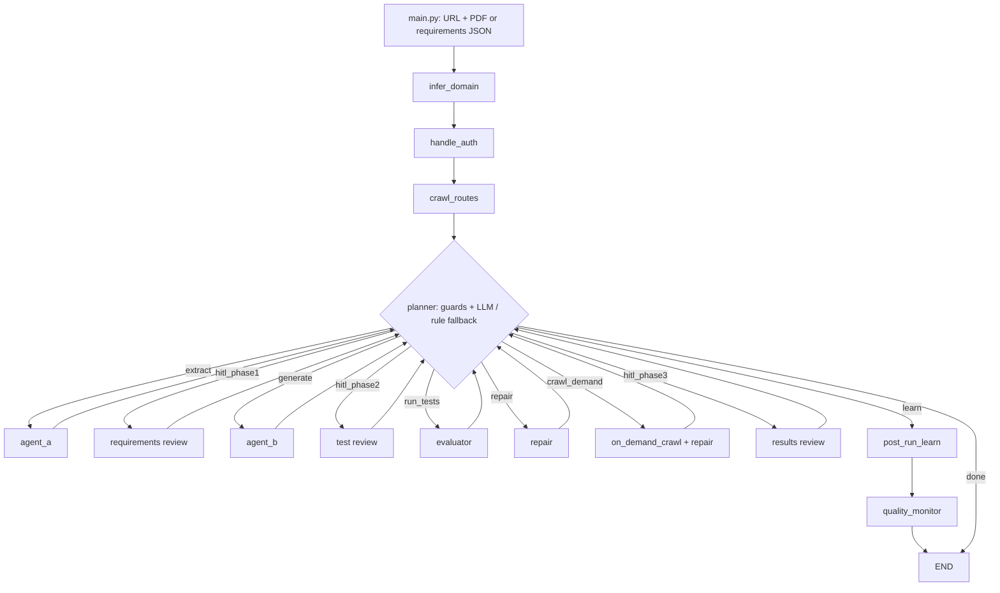

# Existing architecture

## Consolidated assurance review - 2026-10-25

Revision **ATS-ARCH-ASSURANCE-2026-10-25-v1**, documentation-only under C21.
This section records the C21 assessment; C23 subsequently implemented the offline
M2-R review subsystem described below. Older dated observations remain historical.
It complements [domain review](DOMAIN_WORKFLOWS_REVIEW.md),
[capability requirements](CAPABILITY_REQUIREMENTS.md) and the six proposed ADRs,
without replacing milestone specifications. No additional assurance document is needed:
this document can own the cross-cutting matrix, while verification records own results.
The reported 116 offline tests are prior evidence, not a new run or a product benchmark.

### Architecture classification and agent boundaries

ATS is a modular Python CLI with an LLM-directed LangGraph workflow and a separate,
deterministic offline authority/lineage subsystem. It is not yet an integrated safe
testing product. The runtime delegates extraction, generation and repair to specialized
functions using models; the planner chooses named actions. Calling these agents is
reasonable, but does not imply autonomous peers, independently trusted adjudicators,
or a general model tool-calling protocol. Browser/HTTP/filesystem tools are invoked
through application functions; current provider calls expose text completions.

| Boundary | Source evidence and classification | Assurance implication |
| --- | --- | --- |
| Orchestration | [build_graph / planner](../app/core/react_controller.py): 14 nodes, fixed infer/auth/crawl startup, conditional middle, SQLite checkpointer; IMPLEMENTED, defective guards/mode/finalization (F07/F08/F13) | Preserve LangGraph; deterministic admission/lifecycle belongs in M4, not prompts |
| Domain contracts/services | [M0 review](../app/core/review_store.py), [M1 policy](../app/core/plan_policy.py), [M2 service](../app/core/artifact_service.py): separate pure policy and small I/O boundaries; VERIFIED OFFLINE in milestone records | Stable baseline -> criterion -> scenario/plan -> test/package/configuration lineage; still disconnected from runtime |
| Human authority | M0 explicit digest-bound single-operator decisions VERIFIED OFFLINE; M1/M2 assessments remain non-authorizing; legacy [HITL](../app/hitl/hitl_manager.py) defective (F04/F11) | M2-R adds separate review records; importing approved flags or a ready assessment cannot grant authority |
| Context/retrieval/memory | [agent memory](../app/memory/agent_memory.py), extraction FAISS, generator prompt/context helpers IMPLEMENTED; benefit/freshness/isolation UNVERIFIED (F15/F16) | Retrieval is untrusted evidence; CAP-EFFICIENCY/EVAL own freshness and held-out comparisons, not additional agents |
| Execution/effect recovery | Legacy [evaluator](../app/core/evaluator_engine.py) executes on host; graph resume exists, safe effect recovery/isolation NOT IMPLEMENTED | M4 reservations and M5 isolation are prerequisites; a checkpoint cannot establish exactly-once target effects |
| Diagnosis/repair | [repair agent](../app/agents/repair_agent.py) and active prompts IMPLEMENTED BUT DEFECTIVE (F01); causal diagnosis/defect retention UNVERIFIED | Evidence-backed hypotheses and reviewed revisions remain CAP-DIAG; green rewritten tests are not successful repair evidence |
| Telemetry/evaluation | [telemetry](../app/core/telemetry.py) JSONL and quality/learning heuristics PARTIAL; maintained model/agent/defect corpus absent | CAP-OBS/EVAL/LAB own complete attempts, trustworthy evidence and effectiveness; unit counts cannot substitute |

Extraction/generation/repair boundaries correspond to different inputs and validation
needs. Keeping them as modules is justified; separate processes or more agents are not
currently justified. Compare simple deterministic services plus one permitted-action
planner with extra agent coordination only when equal-budget held-out evidence shows
better defect sensitivity or authoring effort without safety loss. No new agents were
used or proposed as authorities in this review.
Official [LangGraph interrupt guidance](https://docs.langchain.com/oss/python/langgraph/interrupts)
also requires idempotent side effects before interruption because nodes restart on resume;
this supports retaining the separate effect-recovery boundary rather than trusting replay.

### Framework and language compatibility

Playwright and Selenium are browser automation libraries; Playwright Test, pytest and
JUnit are test frameworks/runners; TypeScript, Python and Java are languages. Chromium,
Firefox and WebKit are browser engines. POM is a test-design/maintenance pattern and
does not select an engine, language or runner. The [Playwright language guidance](https://playwright.dev/docs/languages)
supports different bindings and recommends the pytest plugin for Python. The
[Selenium POM guidance](https://www.selenium.dev/documentation/test_practices/encouraged/page_object_models/)
keeps business assertions in tests; retain explicit criterion assertions and small
page/component helpers rather than a universal base-page hierarchy.

| Candidate profile (future versioned support claim) | Required implementation/evidence | Present ATS status |
| --- | --- | --- |
| Playwright + TypeScript + Playwright Test | Node/package lock, browser/runtime versions, typed imports, explicit test/config IDs, reporter/retry semantics | Legacy inline generator, Node runner and config exist; reliable reconciliation/isolation absent |
| Playwright + Python + pytest/pytest-playwright | Python dependency lock, plugin/fixture versions, sync/async choice, collection IDs and parameterization mapping, browser provisioning | Python Playwright used for discovery/auth only; no Python test-generation/runner adapter |
| Selenium + Java + JUnit | JDK plus selected Maven/Gradle/toolchain/locks, Selenium/driver/browser versions, JUnit discovery and dynamic/parameterized invocation identity | No generator/build/runner/result adapter found |
| Selenium + Python + pytest | Selenium/driver/browser/Python/plugin locks, explicit fixtures, collection/invocation mapping | No generator/runner/result adapter found |
| API/non-browser testing | Justified target/transport and oracle, target credentials/policy, runtime/dependencies, discovery/outcome/evidence adapter without browser assumptions | Deferred CAP-WORKFLOW/FRAMEWORK; observed browser requests are not an API contract |

Recommended extension: an explicit versioned framework profile, capability checks and
small generation/discovery/result/isolated-runner adapters sharing domain IDs. Profile
identity must bind engine/library, runner, language, toolchain and reporter versions,
supported features and dependency/environment provenance; it must participate in future
review/evidence identity, not be an unhashed runtime switch. Start with a curated profile
and existing Playwright TS output; qualify each additional profile with common and
profile-specific tests. No universal test IR or plugin registry is needed. A universal
IR adds semantics/compiler obligations before demonstrating equivalent assertions across
two profiles; reconsider only if measured adapter duplication justifies it.

**M2 constraints, not demonstrated breakage:** [artifact contracts](../app/artifact_contracts.py)
store arbitrary byte payloads and generic spec/helper/fixture/config/lock/runtime roles;
there is no extension restriction to TS. `project_name` is a required string, not a
verified Playwright object; future adapters need an explicit mapping. Each configuration
requires concrete config/runtime/lock files, and each test needs nonempty assertion byte
ranges with exact criterion identity. These declarations can describe other languages,
but do not prove syntax, semantic checks, import closure or installed dependency identity.
For Java, a build descriptor such as pom.xml is not by itself a complete resolved
dependency lock; qualify the selected build tool and an immutable resolved inventory.
Dynamic/generated assertions, JUnit invocations and pytest parameterization need explicit
future mapping; do not assign trusted ATS identities from display names alone.

Limits are 1 MiB/file, 4 MiB total, 256 files, 64 configurations and 5,000 tests;
path policy rejects non-ASCII/reserved/colliding paths. They may constrain large fixtures,
vendor trees, binary runtimes or Java outputs. Keep large installed toolchains outside
V1 candidate payloads under future immutable worker-environment identity; authorize a
versioned extension if a real package cannot be represented, rather than relaxing V1.
M2 has no explicit framework-profile field and forbids unknown fields. Its runtime
descriptor can hold reviewed bytes, but their meaning is not validated. Future profile
schema/validation and exact package/profile/environment binding require a separate
compatibility decision (versioned envelope/sidecar vs V2); no implicit V1 field addition.
Single-scenario test identity and criterion-bound assertion references do not model every
possible multi-criterion/dynamic test. Preserve unsupported cases and defer generalization.

Discovery, config loading, pytest plugins, Java build plugins and dependency installation
may execute code. The [pytest plugin documentation](https://docs.pytest.org/en/stable/how-to/writing_plugins.html)
documents loading local plugins. All such operations belong behind the M5 boundary,
including collection-only commands. Neither POM generation nor a manifest is isolation.
CAP-FRAMEWORK fills a real gap: CAP-EXT defines adapter discipline, CAP-POM structure,
and CAP-WORKFLOW modes, but none previously owned supported language/runner profiles.

### Model and provider interoperability

Source inspected: all six files under `app/llm/` plus router and configuration
declarations. Installed metadata reads (no imports) found OpenAI SDK 2.26.0,
google-genai 1.67.0, LangGraph 1.1.1, Python Playwright 1.58.0 and Pydantic 2.12.5;
the Node manifest declares `@playwright/test` ^1.58.2. Installed state is not a clean
installation result or a newly verified compatibility matrix.

| Finding | Evidence / consequence |
| --- | --- |
| Managed/hosted inference is hardwired | [router](../app/llm/router.py) dispatches Groq, Gemini, OpenRouter, Cerebras and Mistral with configured tier chains. These names do not establish model availability, ownership, license, price or quality |
| Local generation/self-hosting absent | [huggingface](../app/llm/huggingface.py) loads MiniLM embeddings lazily; it may download weights. It is not a local generative deployment or proof of air-gapped operation |
| Text-only common result loses provenance | Four OpenAI-SDK adapters return content strings; [Gemini](../app/llm/gemini.py) separately converts roles/text. Usage, finish/truncation/refusal, request ID and actual served deployment/model are not a common returned record |
| Structured output is not uniform | Router passes response_format to compatible adapters but drops it for Gemini. Passing JSON format through an SDK does not prove schema enforcement. Callers must validate bounded output and classify invalid content separately |
| Tools/streaming/effort not exposed | Current callable signatures lack tool definitions/results, stream lifecycle or reasoning-effort negotiation. OpenRouter strips think blocks; that does not implement portable reasoning control |
| Retry bounds incomplete | Router has finite loops and process-global availability, classifies errors by text and returns first transport-success text. SDK retries compose with router retries: installed OpenAI `_constants.py` sets DEFAULT_MAX_RETRIES=2 and adapters do not override it. There is no cross-layer attempt/token/cost/deadline reservation or quality-triggered escalation contract |
| Reproducibility gap | [requirements](../requirements.txt) lists google-generativeai while source imports google.genai; lower bounds and an installed environment do not prove direct dependencies or reproducible setup (F12) |

Distinguish model identity (weights/revision, fine-tune, quantization where known) from
deployment identity (operator/provider, endpoint/region, served alias/revision, API and
server version, privacy policy). The same open-weight model may run locally, on a
self-hosted server, or via a hosted provider; the capability/privacy/cost envelope differs.
Managed APIs and hosted open weights use the same admission principles. Local inference
still consumes compute/time, may have licensing/hardware constraints and is not inherently
private if model downloads, logging or remote endpoints remain enabled.

Official [vLLM serving documentation](https://docs.vllm.ai/en/latest/serving/openai_compatible_server/)
describes compatible endpoints with model/template-dependent behavior and unsupported
parameters. [Ollama compatibility](https://docs.ollama.com/api/openai-compatibility)
also defines a supported subset and model-specific effort behavior. Inference: an
OpenAI-compatible transport can reduce adapter code but cannot establish semantic
equivalence, tool correctness, JSON-schema fidelity or portable effort levels.

| Alternative | Trade-off / recommendation |
| --- | --- |
| Direct SDK adapters behind an ATS-owned boundary | Least migration from current code; explicit native options and errors, more adapter maintenance. Preferred starting point with a curated versioned capability catalog and deterministic task policy |
| Compatible inference API adapter | Reuses transport for local/self-hosted/hosted deployments; qualify exact server/model/template/options, preserve unsupported/ignored-option behavior and actual deployment provenance |
| Optional gateway/router library or service | Can consolidate integrations/load balancing/retries; adds dependency/operations, data custody and hidden routing/retry concerns. [LiteLLM routing](https://docs.litellm.ai/docs/proxy/load_balancing) and [fallback documentation](https://docs.litellm.ai/docs/proxy/reliability) demonstrate these features, not ATS compatibility or necessity |

Retain CAP-MODEL ownership; no vendor mandate. Future request/result contracts should
carry task, catalog/policy/prompt versions, required schema/tools/stream/effort/context,
privacy/destination policy, deadline and reservation; return requested and actual model/
deployment (unknown explicitly), validation/refusal/finish state, per-attempt usage and
latency/cost provenance. Keep secrets in handles and redact payloads. Abort unsupported
requirements before calls; never silently drop a required option. A stream needs bounded
accumulation, partial/error/cancel states and usage-unknown recovery. Provider failure,
invalid schema, task-quality failure and policy refusal need separate outcomes; a retry
or stronger model cannot rewrite the approved oracle. Contract fixtures precede live
qualification. Benchmark default/fallback vs task-aware/escalation under equal approved
budgets and held-out labels; promotion thresholds need reviewed evidence. Quality remains
unknown until evaluated. CAP-MODEL.A4..A5 below make these interoperability gaps explicit.

### Integration coherence, blockers and reconsideration

| Boundary | Coherent responsibility / required future integration evidence |
| --- | --- |
| M0 -> M1 -> M2 | Exact project/baseline/plan/scenario/test/package identities; one public M0 observation composed with pure policy. Existing real-store tests in [M2 boundaries](../tests/test_m2_artifact_boundaries.py) exercise trace chain, revocation and no authority. This is partial integration proof, not runtime effectiveness |
| M2 -> M2-R | Separate exact plan and whole-package review decisions/history; baseline revocation/supersession and parent-plan changes invalidate effective eligibility. Never mutate frozen M1/M2 assessments to true |
| M2-R -> M3 | Results bind exact reviewed package and configuration/attempt; reports do not create approval. Trusted worker provenance remains M5; a synthetic or forged reporter pass is not real execution evidence |
| M3 -> M4 | Agree result/attempt/retry vocabulary before lifecycle integration. M4 owns deterministic admission, global budgets, dispatch/revocation linearization, idempotent reservations and uncertain-effect recovery |
| M4 -> M5 | Supervisor validates closure/materialized bytes/profile/environment and authority at the agreed dispatch point; cancellation/leases cannot prove a target mutation was undone. No fallback to unsafe host runner |
| Product layer | Manual cases can reference baseline criteria outside automation-supported M1; subset automation needs a separate selection contract. AUTHENV/COVERAGE/MODEL/UI and source-aware work remain independent owners |

**Verdict:** no source-demonstrated incompatibility blocks beginning the bounded M2-R
specification. M0/M1/M2 are a coherent identity/authority foundation for later testing,
not yet a complete product path validated by execution. M2-R must specify a separate
effective-review result that consumes unchanged non-authorizing assessments, exact
subjects and fresh M0 authority. It need not solve framework execution compatibility.
If a real review use case cannot identify its exact plan/package without changing V1,
pause that case for an explicit compatibility decision; none was found in this review.

Actual blockers to **trusted execution/product claims**, rather than to M2-R specification:
missing durable reviews, reliable reconciliation, finite shared budgets/effect recovery,
closure/discovery validation, enforceable isolation/target authorization, clean installation,
and seeded-defect evidence. Additional frameworks/providers, a universal IR, more agents,
UI, cloud hosting and adaptive routing are deferred improvements, not reasons to reopen M2.
Reconsider existing ADR directions only on measured SQLite contention/multi-user trust
needs, unrepresentable real packages, reporter identity loss, failed isolation guarantees
or validated quality gains. No full ADR status changes here.

Required eventual end-to-end evidence: synthetic approved baseline -> exact plan/package
-> separate reviews -> changed/revoked review denial -> fake reservation/dispatch/retry
recovery -> trusted isolated collection/execution -> exact result set -> truthful coverage
and diagnosis. Include nested/parameterized/duplicate/missing/foreign/expected-failure
reports, tampered shared helpers, stale identities/profiles, lost acknowledgment,
crash/cancellation and cross-project denials. An owned paired good/seeded-defect lab must
show genuine defects retained after attempted repair, plus false alarms/abstention and
uncertainty. Offline fixtures come first; actual execution needs separate authorization.

### Versioned architecture fitness and assurance matrix

Matrix **ATS-FIT-2026-10-25-v1**. Owners are milestone/workstream responsibilities,
not assigned people. PARTIAL means relevant evidence exists; OPEN means required proof
is absent. Neither means production readiness. Each milestone must name applicable gates,
their reproducible evidence and intentional deferrals; no gate passes on code existence.

| Gate | Existing evidence / status | Missing proof and completion condition | Owner / dependencies |
| --- | --- | --- | --- |
| FIT-01 Traceability | PARTIAL: CAP register, milestone AC matrices, real-store M0-M2 trace tests | Map scoped CAP/AC -> contract -> tests -> verification; demonstrate runtime evidence resolves exact approved revisions with no orphan/foreign IDs | Every milestone; M2-R/M3/M4/M5 integration |
| FIT-02 Contract invariants | PARTIAL: golden/canonical/path/byte/authority tests, historical 116 pass | Rerun affected offline regression suite when implementing; version changes explicitly; future review/reservation/parser tests retain V1 golden bytes and literal-false fields | M2-R then each contract owner |
| FIT-03 Independent code review | OPEN: prior diff reviews documented, independent review attestation absent | Reviewer independent of implementation inspects semantic/security changes, records findings and resolved/unresolved disposition; same-author self-review cannot satisfy this claim | Each implementation milestone; release owner |
| FIT-04 Dependencies/clean install | OPEN: local working venv, lower-bound requirements and Node lock; F12 open | Reproduce named clean environment from intentional direct dependencies/locks, SDK imports and browser/toolchain provisioning; record exact versions and failures, no inherited venv assumption | Development harness / PORT; before runtime qualification |
| FIT-05 CI/lint/format/types | PARTIAL: offline unit command recorded; no verified maintained lint/type/CI gates; npm test scaffold | Establish scoped verified commands and required CI checks, intentional type/lint backlog, reproducible successful artifacts; do not invent passing gates | Development harness; incremental scope before production |
| FIT-06 Threat model/security | PARTIAL: F01-F17 and ADR-04/06 identify threats; controls not integrated | Document trust/assets/data flows and test prompt injection, secret/filesystem/network/process/tenant denials and review/dispatch races; mandatory denials pass on actual boundary | M2-R review trust; M4/M5, AUTHENV/DATA |
| FIT-07 Negative/adversarial tests | PARTIAL: bounded decoding, forged authority, crash/path/malformed fixtures in M0-M2 | Preserve failure assertions; add malicious profiles/results/model content, stale reviews, duplicate effects and uncertain recovery; no hidden skip/weakening | Each milestone; CAP-EXT/EVAL |
| FIT-08 Cross-module integration | PARTIAL: M1/M2 use real M0 store; runtime disconnected | Prove full exact-revision chain, revocation at dispatch, persistence/export/restart compatibility and all result dispositions with fakes then separately authorized worker | M2-R/M3/M4/M5 combined gate |
| FIT-09 Model/agent quality | OPEN: fixed tiers and heuristics are not held-out evaluations | Version corpus/prompts/catalog/policy; measure extraction/design/oracle fidelity, forbidden effects, abstention, latency/tokens/cost and uncertainty against simple baseline | MODEL/EVAL/OBS/LAB; M4 budgets |
| FIT-10 Genuine defect detection | OPEN: no maintained paired good/seeded-defect benchmark | Report defect recall, false positives, eligible repair correctness and retained real defects after repair on held-out owned builds; reviewed thresholds before claim | CAP-DIAG/EVAL/LAB after M5 |
| FIT-11 Operations/recovery | PARTIAL: M0 crash/review tests; runtime effects/telemetry incomplete | Crash/reservation/cancel/uncertain-mutation drills, complete attempt usage including failures, bounded outputs/redaction and backup/restore/retention evidence | M4/M5/OBS/RECOVERY/DATA |
| FIT-12 Portability | OPEN: Windows offline evidence only | Meet CAP-PORT.A1/A2 on at least two named profiles with equivalent authority/security/identity, migration and rollback; no universal cloud claim | PORT after supported runtime/worker contracts |
| FIT-13 Documentation accuracy | PARTIAL: dated milestone records and scope gates; historical sections retained | Validate current links/anchors/inventory, separate old observations from current claims and source vs runtime evidence; update register/roadmap/decisions/handoff | Every change; this documentation pass |
| FIT-14 Professional UX | OPEN: legacy review HTML/CLI, no professional product usability evidence | CAP-HITL representative review/manual/selection/challenge/resume tasks, truthful durable state, permission/stale-action tests and ROADMAP WCAG 2.2 AA checks | Private UI after authoritative services; SC-01 separate |

Fitness gates preserve all CAP workstreams, including MANUAL, AUTHENV, COVERAGE,
FRAMEWORK/POM, MODEL, DIAG, black-box/source-aware WORKFLOW, HITL, OBS/EVAL/LAB,
PORT and SC-01. Detailed acceptance stays in the register and roadmap. Confidence is
high in static interface findings and unchanged V1 compatibility; medium in future
profile/model boundaries until representative packages and contract fixtures exist.
No live inference, clean install, application execution, quality benchmark or independent
review was performed here. The next bounded task is specified in [NEXT_STEPS](NEXT_STEPS.md).

### Documentation-only verification - C21

Read-only Python standard-library inspection of all nine changed/new Markdown paths
resolved **352 local links and 152 source/heading anchors**, with balanced code fences
and no replacement characters. `git diff --check` passed. SHA-256 comparison against
the pre-edit inventory found all **66 tracked non-documentation files unchanged**;
all **15 tracked milestone/ADR specifications and verification documents** in the
protected inventory also remained unchanged. Existing AUDIT_FINDINGS edits and the
untracked DOMAIN_WORKFLOWS_REVIEW were retained; no edits were made to either file.
Seven documents received C21 additions; the other two paths are preexisting C20 work.
Existing domain CAP/acceptance IDs and SC-01 remain present; FRAMEWORK A1..A4,
MODEL A4/A5, AA-D01..05 and FIT-01..14 are the new identifiers.

A bounded common credential-token/private-key-pattern scan of these Markdown files
found no matches; it is not a general proof of absence of sensitive free text. HEAD is
unchanged at the M2 checkpoint, the index is empty, and documentation remains local
and uncommitted. No live remote query, dependency install, application test execution,
provider/model invocation, generated compilation/execution or deployment was performed.
Official documentation was accessed read-only; it does not qualify ATS adapters.

## Offline M2-R plan and whole-package review

The explicitly approved [M2-R v1](M2R_DURABLE_REVIEW.md) is implemented and
[verified offline](M2R_VERIFICATION.md): 157 tests pass, including all 116 unchanged
M0/M1/M2 tests and 41 M2-R methods. A separate `python -B -m app.review_cli` provides
explicit init/register/review/inspect/history/assess/export commands. New strict
review contracts, a small service and a single-project SQLite store preserve exact
canonical plan/package bytes and append-only operator decisions. M0 schemas and all
existing source/interfaces remain unchanged; no legacy runtime integration was added.

New effective-review envelopes consume a fresh public M0 inspection, unchanged M1/M2
structural policy and exact baseline/parent approval-decision tokens. Reapproval cannot
revive an old package review. Request replay acknowledges a historical decision only.
Read-only queries cannot recover hot journals; explicit review/registration may recover
only the identified M2-R store. Header/schema/record checks reject foreign/WAL/corrupt
stores. These controls assume a trusted local operator and cooperative filesystem.

M0 and M2-R observations are not jointly atomic; assessments can immediately become
stale. M1/M2 authority fields stay false, new closure status stays unverified and all
execution authorization stays false. M3 results, M4 admission/recovery, M5 isolation,
independent code review and system-effectiveness proof remain open. F01-F17 are not
closed by this separate offline subsystem. No new runtime agents or dependencies exist.

## Offline M2 artifact packages

The approved [M2 v2](M2_ARTIFACT_PACKAGES.md) is implemented and
[verified offline](M2_VERIFICATION.md). `python -B -m app.artifact_cli` exposes help,
version, test-id, validate, freeze and assess. New artifact contracts own strict frozen
manifest/package records, context-limited bounded JSON/base64 decoding, exact raw-byte
integrity, conservative logical paths, canonical identity and test UUIDs. Pure artifact
policy validates complete scenario dispositions, explicit configuration memberships and
criterion-bound assertion byte ranges. The small service takes exactly one public M0
inspection and composes M1 policy from it. The CLI reuses unchanged M0 single-file helpers.

Packages retain candidate bytes inside one inert JSON export; nothing is unpacked,
compiled, loaded or run. Assertion ranges are declared review locations, not proof of
semantics. Closure stays unverified and package/execution authority stays false. No
artifact database or runtime integration exists. M0/M1 source, interfaces and canonical
rules are unchanged. The full suite has 116 offline tests; F01-F17 remain open.

Historical architecture/specification notes follow.

Post-M1 note, 2026-10-25: [M2 artifact packages](M2_ARTIFACT_PACKAGES.md) is a
proposed offline extension, not implemented architecture. It consumes existing M0/M1
interfaces without changing them. Durable review, execution closure, reconciliation,
reservations and isolation remain later boundaries. The current full offline regression
rerun passed 78 tests; no existing runtime finding was closed.

This describes implementation inspected on 2026-10-22. Proposed changes belong
in [DECISIONS](DECISIONS.md), defects in [AUDIT_FINDINGS](AUDIT_FINDINGS.md), and
environment/validation limits in [CURRENT_STATE](CURRENT_STATE.md).

The 2026-10-23 [six proposed ADRs](adr/README.md) describe the future foundations;
[M0](M0_VERSIONED_BASELINES.md) is the proposed first offline slice and
[ROADMAP](ROADMAP.md) preserves the wider product assessment. None of those proposals
changes the runtime graph described below. M0 was subsequently explicitly approved
and implemented as a separate offline subsystem; its boundary is described here.

## Offline M0 baseline and review subsystem

`python -B -m app.baseline_cli` provides explicit prepare, validate, freeze, review,
inspect and history operations. [Contracts](../app/baseline_contracts.py) contain
immutable V1 records/canonicalization; [baseline review](../app/core/baseline_review.py)
contains the bounded legacy adapter and approval rules; [review store](../app/core/review_store.py)
owns SQLite snapshots, sequence checks and append-only decisions. A small
[file boundary](../app/core/baseline_files.py) is shared by store and CLI.

The runtime graph does not consume this new authority. Existing approval, runner,
repair, accounting and isolation defects remain open. M0 has no imports from runtime
configuration/providers and no execution capability. See [verification](M0_VERIFICATION.md).

## Offline M1 authority-bound scenario plans

The separately approved `M1-SPEC-2026-10-25-v2` is implemented and
[verified offline](M1_VERIFICATION.md). `python -B -m app.plan_cli` provides bounded
scenario-id, validate, freeze and assess operations. [Plan contracts](../app/plan_contracts.py)
own immutable V1 records, deterministic scenario keys, plan-specific canonicalization
and safe errors. [Pure policy](../app/core/plan_policy.py) validates complete criterion
dispositions and derives readiness; [the service](../app/core/plan_service.py) consumes
one public `ReviewStore.inspect` observation per command. The CLI reuses existing M0
bounded file/exclusive export helpers. No new database or approval write exists.

Plans bind exact baseline/criterion identity and retain unsupported/unplanned scope.
Freeze publishes proposals, including blocked content; assess rereads effective M0
authority. Both `plan_approved` and `execution_authorized` are always false. A coherent
read can become stale immediately. Scenario text is not a second oracle or proof of
semantic fidelity. No M0 schema/API/canonical bytes or legacy runtime source changed.
The full offline suite now has 78 tests: 48 unchanged M0 plus 30 M1 acceptance cases.

## Runtime boundary

ATS is a local Python CLI. It uses direct HTTP/provider SDK calls, Python
Playwright for discovery/authentication, and Node Playwright for generated tests.
There is no product MCP integration, hosted upload API, worker isolation layer,
or POM generation pipeline. Codex's development tools/instructions are separate
from this product runtime.

## Graph and state

[`build_graph()`](../app/core/react_controller.py#L651) registers 14 nodes.
Startup is fixed: infer_domain -> handle_auth -> crawl_routes -> planner.
The planner chooses the middle transitions. Every extraction, generation,
evaluation, repair, on-demand crawl, or HITL node returns to the planner.
Finalization is post_run_learn -> quality_monitor -> END; the planner can also
choose done and route directly to END.

[`AgentState`](../app/core/react_controller.py#L42) is a TypedDict carrying run
identity/mode, URL and input paths, resource/auth/domain dictionaries, selector
map, requirement bundle, test suite, report, three feedback records, counters,
coverage history, planner reasoning, and flags. Pydantic models are reconstructed
inside nodes; there is no application-wide strict state validation layer.

[`run_pipeline()`](../app/core/react_controller.py#L715) compiles a StateGraph with
SqliteSaver and invokes it with `thread_id=run_id`. Resume invokes the graph with
`None` for the same thread. This is checkpoint support, not proof of replay-safe
effects or a verified resume flow. Raw resource/auth data enter checkpointed state.

## Components and data flow

| Component | Implemented responsibility | Entry point |
| --- | --- | --- |
| CLI | run/resume/list/validate/keys; resource JSON resolution | [main.py:103](../main.py#L103) |
| Domain inference | Fetch homepage/sitemap/robots; classify domain and suggest routes | [infer_domain:149](../app/agents/domain_inferrer.py#L149) |
| Authentication | Form login/storage state, bearer acquisition, API-key headers | [handle_auth:21](../app/core/auth_handler.py#L21) |
| Discovery | Sitemap/robots/link routes, LLM route completion, browser selector scoring, API request paths | [crawl:306](../app/core/route_crawler.py#L306) |
| PDF processing | Validate extension/magic; extract text/tables; OCR if all text is empty; chunk/hash | [load_pdf:179](../app/core/pdf_extractor.py#L179) |
| Agent A | Raw extraction, FAISS enrichment, validation/filtering, gap synthesis, Jaccard deduplication | [run_extraction:469](../app/agents/extraction_agent.py#L469) |
| Agent B | Inject memory/selectors/prompts; generate inline TS tests; deduplicate | [run_codegen:423](../app/agents/codegen_agent.py#L423) |
| Evaluator | Delete/write specs; subprocess execution; results, selector heuristics, metrics | [evaluate:448](../app/core/evaluator_engine.py#L448) |
| Agent C | Rewrite failed test blocks using code/errors/selectors/snapshots; optional recrawl | [repair_batch:196](../app/agents/repair_agent.py#L196) |
| Human review | Two static HTML reviews with localhost feedback endpoint; terminal results review | [hitl_manager.py](../app/hitl/hitl_manager.py) |
| Learning | Extract heuristics from feedback/repairs/failures; update memory and metrics | [run_learner:313](../app/core/post_run_learner.py#L313) |
| Reporting | Anomaly heuristics, HTML report, static telemetry dashboard | [record_and_report:247](../app/core/quality_monitor.py#L247) |

Startup inference/auth/crawl happens even for extract-only. Agent A accepts a saved
RequirementBundle as an alternative to PDF extraction. PDF chunks default to
4,000 characters with zero overlap. The enrichment heuristic looks for descriptions
without terminal punctuation. Validation can remove requirements; gap analysis
adds inferred ones; deduplication can remove semantically distinct items.

Noninteractive extraction approves all nonrejected requirements, including gaps.
Saved bundles are also auto-approved unless rejected. Interactive review is
planner-selected, not a deterministic prerequisite for execution.

Agent B generates up to ten requirements per batch, optionally concurrent through
a thread executor with an asyncio semaphore. Output is a list of TestCase records
containing inline `ts_code` and `spec_file`. It is not a multi-file POM artifact
contract. Active prompt files take precedence over embedded defaults.

The evaluator groups all tests by filename, deletes existing top-level specs in
the shared tests directory, then writes imports/test blocks. It calls
`npx playwright test --reporter=json`, passing the host environment plus base URL
and output path. The CLI reporter override means the configured HTML/list reporters
are not evidence those reporters run through this invocation.

The current Playwright configuration uses Chromium, one worker, no runner retries,
90-second test timeout, failure screenshots, and traces/video disabled. The evaluator
uses a suite deadline of `max(300, test_count * 30 + 60)` seconds. A timeout yields
empty results, subsequently represented as failures, without dependable distinction
between test, startup, and infrastructure causes.

Results are matched by title/code substring. Error strings are classified into
selector/strict-mode/assertion/timeout/network/unknown categories. These categories
do not decide whether the application violates its specification. Error-context
Markdown is matched by folder slug and truncated to 3,000 characters; repair
truncates it again to 2,000. It is a Playwright snapshot, not a complete live DOM.

Repair sends up to eight tests per batch and accepts rewritten code in place.
`repair_count` counts accepted replacements. The planner forces evaluation after
repair/recrawl. `loop_count` increases only on evaluation; defaults and limits are
documented in CURRENT_STATE. Stall detection uses absolute coverage deltas below
two percentage points. Guards and the LLM/rule policy have gaps listed in F07.

## Provider routing and persistence

[`complete()`](../app/llm/router.py#L153) chooses provider/model fallback chains
by tier, retries with delays, and maintains process-global provider availability.
Configured primary roles are Llama 8B for classification, Gemini for extraction,
Kimi K2 for code generation/repair, Llama 70B for reasoning, and local MiniLM for
embeddings. These are configuration observations, not verified current provider
availability, pricing, or quality. Local embeddings may download on first use.

| Storage | Existing use | Important limit |
| --- | --- | --- |
| cache/checkpoints.db | Serialized graph checkpoints and pending work | Resume/replay not integration-tested; list query broken |
| cache/requirements_*.json | PDF-hash-based bundle cache | Omits target, prompt/model versions, extraction config |
| memory/chroma_db/ | Lessons and repair strategies | Confidence/relevance heuristics; benefit not benchmarked |
| memory/domain_selectors.json | Domain/page selector records | No robust freshness/version policy or atomic concurrency handling |
| memory/hallucination_list.json | Selector blocklist | Retrieval is global across domains |
| memory/run_metrics.json | Historical metrics | Not an authoritative evaluation dataset |
| output/ | Reports, feedback, results, possible auth storage state | Sensitive data possible; shared paths; no retention/access policy |
| monitoring/ | JSONL events and generated dashboard | Heuristic scores and missing/misleading measurements |
| playwright_project/tests/ | Materialized generated test blocks | Shared mutable directory, not ATS regression tests |

Schemas, optional source fields, and ID relationships live in
[app/schemas.py](../app/schemas.py). These provide a useful starting point but do
not enforce an immutable acceptance baseline. Preserve these implemented
responsibilities while addressing defects; replacement architecture is unapproved.
