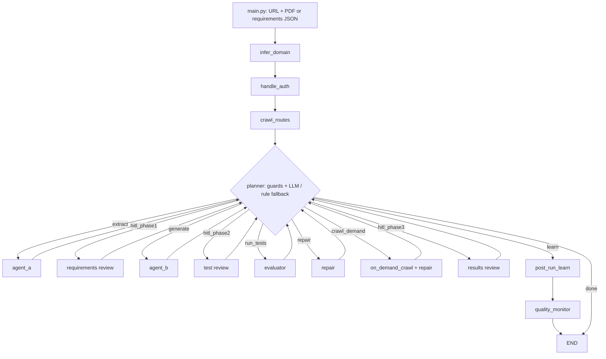

# Existing architecture

This describes implementation inspected on 2026-10-22. Proposed changes belong
in [DECISIONS](DECISIONS.md), defects in [AUDIT_FINDINGS](AUDIT_FINDINGS.md), and
environment/validation limits in [CURRENT_STATE](CURRENT_STATE.md).

The 2026-10-23 [six proposed ADRs](adr/README.md) describe the future foundations;
[M0](M0_VERSIONED_BASELINES.md) is the proposed first offline slice and
[ROADMAP](ROADMAP.md) preserves the wider product assessment. None of those proposals
changes the implemented architecture described below.

## Runtime boundary

ATS is a local Python CLI. It uses direct HTTP/provider SDK calls, Python
Playwright for discovery/authentication, and Node Playwright for generated tests.
There is no product MCP integration, hosted upload API, worker isolation layer,
or POM generation pipeline. Codex's development tools/instructions are separate
from this product runtime.

## Graph and state

[`build_graph()`](../app/core/react_controller.py#L651) registers 14 nodes.
Startup is fixed: infer_domain -> handle_auth -> crawl_routes -> planner.
The planner chooses the middle transitions. Every extraction, generation,
evaluation, repair, on-demand crawl, or HITL node returns to the planner.
Finalization is post_run_learn -> quality_monitor -> END; the planner can also
choose done and route directly to END.

[`AgentState`](../app/core/react_controller.py#L42) is a TypedDict carrying run
identity/mode, URL and input paths, resource/auth/domain dictionaries, selector
map, requirement bundle, test suite, report, three feedback records, counters,
coverage history, planner reasoning, and flags. Pydantic models are reconstructed
inside nodes; there is no application-wide strict state validation layer.

[`run_pipeline()`](../app/core/react_controller.py#L715) compiles a StateGraph with
SqliteSaver and invokes it with `thread_id=run_id`. Resume invokes the graph with
`None` for the same thread. This is checkpoint support, not proof of replay-safe
effects or a verified resume flow. Raw resource/auth data enter checkpointed state.

## Components and data flow

| Component | Implemented responsibility | Entry point |
| --- | --- | --- |
| CLI | run/resume/list/validate/keys; resource JSON resolution | [main.py:103](../main.py#L103) |
| Domain inference | Fetch homepage/sitemap/robots; classify domain and suggest routes | [infer_domain:149](../app/agents/domain_inferrer.py#L149) |
| Authentication | Form login/storage state, bearer acquisition, API-key headers | [handle_auth:21](../app/core/auth_handler.py#L21) |
| Discovery | Sitemap/robots/link routes, LLM route completion, browser selector scoring, API request paths | [crawl:306](../app/core/route_crawler.py#L306) |
| PDF processing | Validate extension/magic; extract text/tables; OCR if all text is empty; chunk/hash | [load_pdf:179](../app/core/pdf_extractor.py#L179) |
| Agent A | Raw extraction, FAISS enrichment, validation/filtering, gap synthesis, Jaccard deduplication | [run_extraction:469](../app/agents/extraction_agent.py#L469) |
| Agent B | Inject memory/selectors/prompts; generate inline TS tests; deduplicate | [run_codegen:423](../app/agents/codegen_agent.py#L423) |
| Evaluator | Delete/write specs; subprocess execution; results, selector heuristics, metrics | [evaluate:448](../app/core/evaluator_engine.py#L448) |
| Agent C | Rewrite failed test blocks using code/errors/selectors/snapshots; optional recrawl | [repair_batch:196](../app/agents/repair_agent.py#L196) |
| Human review | Two static HTML reviews with localhost feedback endpoint; terminal results review | [hitl_manager.py](../app/hitl/hitl_manager.py) |
| Learning | Extract heuristics from feedback/repairs/failures; update memory and metrics | [run_learner:313](../app/core/post_run_learner.py#L313) |
| Reporting | Anomaly heuristics, HTML report, static telemetry dashboard | [record_and_report:247](../app/core/quality_monitor.py#L247) |

Startup inference/auth/crawl happens even for extract-only. Agent A accepts a saved
RequirementBundle as an alternative to PDF extraction. PDF chunks default to
4,000 characters with zero overlap. The enrichment heuristic looks for descriptions
without terminal punctuation. Validation can remove requirements; gap analysis
adds inferred ones; deduplication can remove semantically distinct items.

Noninteractive extraction approves all nonrejected requirements, including gaps.
Saved bundles are also auto-approved unless rejected. Interactive review is
planner-selected, not a deterministic prerequisite for execution.

Agent B generates up to ten requirements per batch, optionally concurrent through
a thread executor with an asyncio semaphore. Output is a list of TestCase records
containing inline `ts_code` and `spec_file`. It is not a multi-file POM artifact
contract. Active prompt files take precedence over embedded defaults.

The evaluator groups all tests by filename, deletes existing top-level specs in
the shared tests directory, then writes imports/test blocks. It calls
`npx playwright test --reporter=json`, passing the host environment plus base URL
and output path. The CLI reporter override means the configured HTML/list reporters
are not evidence those reporters run through this invocation.

The current Playwright configuration uses Chromium, one worker, no runner retries,
90-second test timeout, failure screenshots, and traces/video disabled. The evaluator
uses a suite deadline of `max(300, test_count * 30 + 60)` seconds. A timeout yields
empty results, subsequently represented as failures, without dependable distinction
between test, startup, and infrastructure causes.

Results are matched by title/code substring. Error strings are classified into
selector/strict-mode/assertion/timeout/network/unknown categories. These categories
do not decide whether the application violates its specification. Error-context
Markdown is matched by folder slug and truncated to 3,000 characters; repair
truncates it again to 2,000. It is a Playwright snapshot, not a complete live DOM.

Repair sends up to eight tests per batch and accepts rewritten code in place.
`repair_count` counts accepted replacements. The planner forces evaluation after
repair/recrawl. `loop_count` increases only on evaluation; defaults and limits are
documented in CURRENT_STATE. Stall detection uses absolute coverage deltas below
two percentage points. Guards and the LLM/rule policy have gaps listed in F07.

## Provider routing and persistence

[`complete()`](../app/llm/router.py#L153) chooses provider/model fallback chains
by tier, retries with delays, and maintains process-global provider availability.
Configured primary roles are Llama 8B for classification, Gemini for extraction,
Kimi K2 for code generation/repair, Llama 70B for reasoning, and local MiniLM for
embeddings. These are configuration observations, not verified current provider
availability, pricing, or quality. Local embeddings may download on first use.

| Storage | Existing use | Important limit |
| --- | --- | --- |
| cache/checkpoints.db | Serialized graph checkpoints and pending work | Resume/replay not integration-tested; list query broken |
| cache/requirements_*.json | PDF-hash-based bundle cache | Omits target, prompt/model versions, extraction config |
| memory/chroma_db/ | Lessons and repair strategies | Confidence/relevance heuristics; benefit not benchmarked |
| memory/domain_selectors.json | Domain/page selector records | No robust freshness/version policy or atomic concurrency handling |
| memory/hallucination_list.json | Selector blocklist | Retrieval is global across domains |
| memory/run_metrics.json | Historical metrics | Not an authoritative evaluation dataset |
| output/ | Reports, feedback, results, possible auth storage state | Sensitive data possible; shared paths; no retention/access policy |
| monitoring/ | JSONL events and generated dashboard | Heuristic scores and missing/misleading measurements |
| playwright_project/tests/ | Materialized generated test blocks | Shared mutable directory, not ATS regression tests |

Schemas, optional source fields, and ID relationships live in
[app/schemas.py](../app/schemas.py). These provide a useful starting point but do
not enforce an immutable acceptance baseline. Preserve these implemented
responsibilities while addressing defects; replacement architecture is unapproved.
