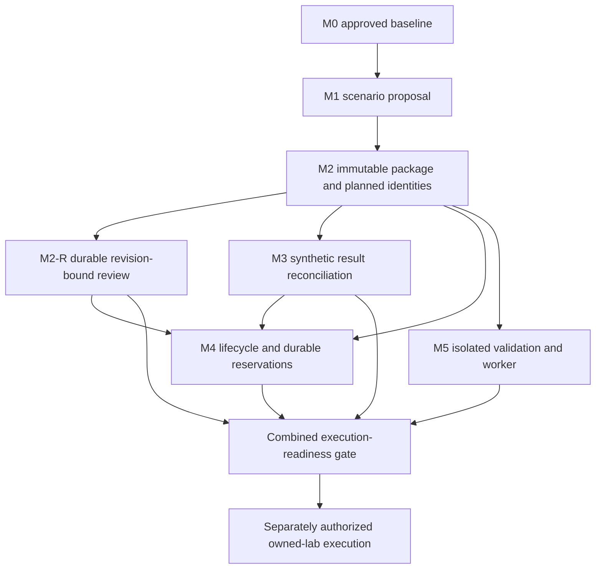

# M2: immutable artifact packages and mapping assessment

Revision: **M2-SPEC-2026-10-25-v2**. Status: **IMPLEMENTED AND VERIFIED OFFLINE**.
The user explicitly approved M2-D01..07, V1 contracts and M2-AC-01..26, then approved
this narrow decoder correction and resumed implementation/local checkpoint authority.
No full ADR or later milestone is accepted. Historical proposal language below records
the design rationale; the current approval supersedes its unapproved status only for M2.

## V2 decoder correction and preflight

V1 required M0's existing decoder, whose ordinary 16,384-character string cap limits
base64 payloads to 12,288 bytes. This contradicted 1 MiB/file and 4 MiB total payload.
A deterministic preflight probe confirmed rejection at 12,289 bytes and 1 MiB; no
application implementation had started. The user explicitly approved this V2 correction.
M0/M1 source, decoder behavior, all seven decisions and 26 acceptance families remain
unchanged. AC-18 now explicitly includes the following decoder subcases.

Use a separate M2 decoder built on stdlib JSON, with an 8 MiB wire check before UTF-8
conversion/parsing, depth scan before JSON allocation, duplicate-key/nonfinite rejection,
and bounded node/structure traversal after parsing. Ordinary strings and keys retain
16,384 characters and existing control/surrogate rejection. Only exact recognized
candidate/package root `payloads` entries of shape `{path, content_base64}` permit a
larger `content_base64` value. The same name at other depths, unknown root keys, malformed
entries or other structures grant no exception. Pydantic validates the full strict schema.

The base64 bound is `4 * ceil(1048576 / 3) = 1398104` characters. Check length before
base64 decoding, strict alphabet/padding and canonical re-encoding; check decoded length
<= 1 MiB afterward. Compute exact projected decoded sizes from canonical length/padding
and reject aggregate > 4 MiB before decoding payloads; independently total actual decoded
sizes afterward. Accept only standard JSON objects at the package/candidate boundary;
reject BOM, malformed UTF-8, lone surrogates, NaN/Infinity and noncanonical base64.

Second-order check: four 1 MiB files encode to 5,592,416 characters; their metadata and
three small config/lock/runtime files can fit below 8 MiB by distributing the 4 MiB
budget across data/spec and metadata bytes. At 256 files the combined base64 padding
adds at most 680 bytes beyond `4/3` of decoded bytes. Aggregate/canonical package and
node caps still independently constrain combinations; limits are ceilings, not a promise
that every maximum-count/maximum-text combination fits. Wire whitespace/escaping also
counts toward 8 MiB. No archive/directory reader or streaming parser is needed.

Explicit AC-18 decoder subcases: 12,288/12,289-byte payload compatibility; per-file
1 MiB minus one/exact/plus one; encoded-length exact/plus one and decoded-overflow with
the same encoded length; aggregate 4 MiB minus one/exact/plus one; 256/257 files; wire
8 MiB exact/plus one; canonical-size overflow; 16,384/16,385 ordinary strings and keys;
spoofed base64 locations/entry shapes/unknown roots; noncanonical padding/unused bits,
Unicode errors, duplicate keys, depth 32/33 and nodes 100000/100001. Verify encoded and
aggregate prechecks prevent calls to the decoder on oversized payloads.

Memory trade-off: stdlib JSON allocates the bounded wire string and parsed tree before
context-sensitive string checks. Avoid a custom streaming JSON parser; the 8 MiB input,
preparse depth scan and postparse node/field bounds cap exposure. Decoding is per file
with bounded temporary raw/re-encoded bytes; no need to retain a second raw-byte bundle.
Python callers already own their input allocation but receive equivalent structural,
encoded, decoded, aggregate and canonical-output checks before success.

## Verified post-M1 starting point

On 2026-10-25, inspection began with a clean index/worktree on `main` at
`58c1faef6fb6b96e126e67afa73e6c3af2cce41f`, the M1 implementation commit, whose parent
is `d17974a9ac17f209ed110a86b11c504e2cc3bc49`. Local tracking comparison was behind 0,
ahead 1. No fetch or live remote query occurred; this does not verify remote state.

After inspecting the existing tests' effects, the current checkout was verified with:

```powershell
.\.venv\Scripts\python.exe -B -m unittest discover -s tests -p "test_*.py" -v
```

**78 tests passed in 28.819 seconds, zero failures/errors/skips**: 48 M0 and 30 M1.
This is a new regression run, separate from the historical results in
[M0 verification](M0_VERIFICATION.md) and [M1 verification](M1_VERIFICATION.md).
Tests use synthetic data, temporary stores, controlled test-owned Python processes
and Windows junction fixtures. No generated code, provider, crawler or browser ran.
This does not verify clean installation, hostile same-user security or live execution.

The premise needs one qualification: M1 produces **authority-bound scenario proposals**,
not approved scenario plans. `PlanAssessmentV1.plan_approved` and
`execution_authorized` are literal false. M0 approval covers the baseline, not the plan.

| Actual source boundary | Consequence |
| --- | --- |
| [ScenarioPlanV1 and scenario_id](../app/plan_contracts.py) | Digest binds plan content; scenario identity uses project, criterion and retained scenario key. Tests can reference this without changing M1. |
| [validate_plan_references / assess_plan](../app/core/plan_policy.py) | Complete criterion dispositions, no unsupported scenario substitution, fresh approval observation. Reuse these rules instead of duplicating them. |
| [inspect_plan / prepare_plan](../app/core/plan_service.py) | One public M0 inspection per operation; no new store or approval authority. |
| [ReviewStore.inspect](../app/core/review_store.py#L305) | Snapshot and effective review share a read transaction. A later file operation is not atomic with it. |
| [CriterionRevisionV1](../app/baseline_contracts.py#L224) | Baseline digest plus criterion ID pins expected outcome, requirement and source references. No second oracle is needed. |
| [baseline_files](../app/core/baseline_files.py) | Bounded explicit single-file read/export and Windows path checks can be reused unchanged. They are not a sandbox or recursive bundle materializer. |
| [write_spec_files](../app/core/evaluator_engine.py#L67) | Deletes shared specs and transforms code during writing. It cannot publish reviewed final bytes without a later explicitly scoped replacement. |
| [run_playwright](../app/core/evaluator_engine.py#L106) | Inherits host environment; cannot be used for validation, discovery or execution of M2 content. |
| [parse_results](../app/core/evaluator_engine.py#L260), [legacy graph](../app/core/react_controller.py) | Title mapping, lifecycle and checkpoint effects remain separate unresolved runtime concerns. |

All F01-F17 remain open. This is bounded dependency inspection, not a repeated audit.

## Dependency analysis and recommended boundary

Recommend **M2: inert, immutable artifact packages with explicit planned mappings**.
An operator supplies candidate bytes and mappings, freezes one package, verifies byte
integrity, and observes whether its inventory is complete against an M1 plan and current
M0 authority. Nothing loads candidate code. The deliverable is trustworthy byte identity
and traceability, not trustworthy execution or proof of assertion correctness.

The earlier [foundation outline](POST_M0_FOUNDATIONS.md) grouped manifests, review,
static eligibility and materialization into M2. Split that proposal: **M2-R** is a later,
separately specified durable plan/bundle-review slice. Keep M3/M4/M5 names for the existing
result, lifecycle/effect and isolation boundaries. This is a proposed refinement, not
an already approved roadmap change or removal of those requirements.



Arrows mean dependencies, never authorization. M3 can use synthetic attempt contexts;
M4 later owns their durable issuance. M5 threat-model/design work can occur earlier
under its own scope, but actual worker dispatch requires the combined gate.

| Capability | Needed now | Later enforcement / prerequisite |
| --- | --- | --- |
| Immutable identities/manifests | Exact candidate bytes, declared complete inventory, final-content digest | M5 verifies actual dependency/runtime closure and exact materialization; a declared inventory is not closure proof. |
| Scenario-to-test mapping | Explicit scenario/test/configuration membership with missing scenarios visible | M3 reconciles actual observations against these sets; M5 validates actual discovery against declarations. |
| Revision-bound eligibility | Non-authorizing inventory assessment bound to current baseline and exact plan/package | M2-R records trusted reviews; M4 rechecks effective authority at dispatch under an explicit revocation protocol. |
| Deterministic lifecycle | Fixed offline commands and unconditional execution denial | ADR-02/M4 needs concrete subjects, result vocabulary and reservation semantics; an isolated state machine first would only simulate enforcement. |
| Effect/budget reservations | No provider/worker effects exist in M2; finite input bounds suffice | ADR-06/M4 reserves before dispatch, reconciles duplicates and unknown usage; checkpoints and review request IDs are insufficient. |
| Result reconciliation | Planned test/configuration set and minimal correlation shape | M3 handles nested results, retries, missing/foreign identities and runner errors; requires no live runner. |
| Generated-code isolation | Explicitly no imports, config loads, installs, discovery or compilation of supplied code | ADR-04/M5 enforces filesystem/process/network/resource/secret boundaries and trusted evidence. |
| Assertion preservation | Pin oracle references and assertion byte ranges; never transform content | M2-R human review, M5 validation and later ADR-05 seeded-defect evaluations establish fidelity evidence. Hashes/ranges cannot prove semantics. |

## Consequential decisions and rationale

M2-D01..07 were explicitly approved within the M2 scope. The rationale below is
retained; executed acceptance evidence is owned by [M2 verification](M2_VERIFICATION.md).

### M2-D01: separate custody from review and execution

- **WHAT/WHY now:** supply stable review subjects before introducing a second authority
  store. M1 has no plan approval and M0 review commands only accept baseline subjects.
- **HOW:** an offline package service consumes M0/M1; no database or graph changes.
  M2-R must define independent plan review and whole-bundle review (possibly one explicit
  combined operator decision), revocation, idempotency and stale-sequence rejection.
  Pre-generation plan approval, if required by product policy, also belongs there.
- **Alternative/trade-off:** deliver original broad M2 including review and materializer.
  That reduces handoffs but combines new persistence, authority and filesystem boundaries.
  Manifest-only metadata is smaller still, but cannot retain the bytes the digest names.
  The package is the smallest independently inspectable, recoverable artifact unit.
- **Failure/invariant:** no `approved` input or cached assessment grants authority;
  execution is always denied. M0 review records cannot be repurposed for packages.
- **Evidence:** AC-01, 12..16, 24..26. **Reconsider:** if a concrete review workflow can be
  added without ambiguous authority semantics, separately revise the scope before coding.

### M2-D02: one canonical package, no directory materialization

- **WHAT/WHY now:** retain final candidate bytes and their inventory without partial
  directory publication, recursive scans or accidental executable loading.
- **HOW:** one bounded JSON file embeds canonical manifest plus base64 payloads. Hash
  raw bytes; package identity hashes the manifest. The manifest hashes every payload.
  Export through existing exclusive M0 single-file helpers without changing their bounds.
- **Alternative/trade-off:** content-addressed directory/ZIP allows larger bundles but
  introduces extraction, traversal, partial-publication and cleanup rules. Base64 costs
  space and duplicates equal payloads; bounded local prototypes justify the simpler form.
- **Failure/invariant:** no transforms after hashing; missing/extra/tampered payloads fail;
  changed helper/config/lockfile invalidates package identity. A digest is not authorship.
- **Evidence:** AC-02..06, 17..21. **Reconsider:** measured packages exceed limits or real
  worker delivery requires streaming. Version the new transport; preserve logical digest
  semantics or provide an explicit migration rather than silently changing V1.

### M2-D03: explicit test/configuration sets and retained gaps

- **WHAT/WHY now:** M3 needs an expected set; titles and requirement IDs lose scenarios.
- **HOW:** stable test keys under M1 scenario IDs, explicit configuration membership and
  one disposition for every plan scenario. No cross-product is inferred; every declared
  configuration must be used. Full M1 dispositions retain unsupported/unplanned criteria.
- **Alternative/trade-off:** one test per scenario is simpler but constrains variants;
  many-to-many criterion mapping makes attribution ambiguous before an assertion-level
  result model exists. V1 gives each test one scenario and its primary criterion.
- **Failure/invariant:** duplicate titles are allowed; duplicate identities, foreign
  scenarios, dangling configurations and hidden omissions fail or visibly block readiness.
- **Evidence:** AC-07..11. **Reconsider:** independently reviewed examples require shared
  multi-criterion assertions; then extend versioned attribution without title matching.

### M2-D04: distinguish declared inventory from execution closure

- **WHAT/WHY now:** an import scanner or manifest cannot establish arbitrary TypeScript's
  reachable dependencies, generated tests, dynamic loads or truthful assertions.
- **HOW:** include declared runner/configuration/dependency identity and reference all
  files. Report `closure_status=unverified` and `execution_authorized=false` unconditionally.
  Do not offer an `eligible_to_execute` result in M2. Syntax/type/discovery validation
  and actual runtime/environment matching remain prerequisites under M5's boundary.
- **Alternative/trade-off:** whitelist regex import syntax now; cheaper than parsing but
  unsound as a completeness proof. A restricted generated language may later be useful,
  but needs its own grammar, compiler and compatibility decision. No parser installed now.
- **Failure/invariant:** even a fully mapped package containing dynamic imports remains
  unverified. Missing declared file references reject structurally; undisclosed dependencies
  may remain undetected and cannot produce an execution permit.
- **Evidence:** AC-05, 11, 16, 24. **Reconsider:** a reviewed restricted generator and pinned
  isolated toolchain demonstrate enforceable closure; add evidence records, not a Boolean claim.

### M2-D05: pin the oracle and preserve assertion evidence without claiming proof

- **WHAT/WHY now:** F01 allows changed expectations to hide genuine application defects.
- **HOW:** every test references its exact baseline criterion and one or more candidate
  assertion byte ranges in packaged files. M0 remains the only approved oracle. Every
  edit changes package identity and will require new bundle review later, including edits
  outside assertion ranges. No repair/generation or assertion rewriting is introduced.
- **Alternative/trade-off:** copying expected prose into the manifest risks two oracles;
  static assertion counting falsely accepts empty loops and swallowed errors. Ranges aid
  human inspection but cannot decide whether code enforces the expectation.
- **Failure/invariant:** an altered threshold is a different package, never silently
  inherited approval. Forged ranges, omitted declared checks or helper changes cannot
  escape hashing; semantically vacuous code may still be a valid unapproved candidate.
- **Evidence:** AC-03, 10, 22. **Reconsider:** reliable AST checks improve useful warnings,
  or a constrained assertion IR is justified by held-out defect-sensitivity evidence.

### M2-D06: fresh authority observation, unchanged M0/M1

- **WHAT/WHY now:** stored approval responses and prior readiness are staleable.
- **HOW:** one `ReviewStore.inspect` per assess/freeze/validate operation, then M1's pure
  validation/assessment on that same observation. Never inspect separately per test.
  Immutable package content excludes authority sequences; assessment includes them.
- **Alternative/trade-off:** add M2 tables to M0 or lock M0 across export for stronger
  atomicity; unnecessary for an observation and risks breaking approved contracts.
  M4 must solve cross-store authority/dispatch ordering before claiming execution control.
- **Failure/invariant:** revocation after read may leave an earlier observation but never
  an authorization token. The next assessment blocks. Unrelated sequence advancement
  does not revoke the still-active baseline. Store faults fail explicitly, without recovery writes.
- **Evidence:** AC-12..15, 23, 26. **Reconsider:** actual dispatch or concurrent authenticated
  reviewers require a specified linearization point and new trust/persistence scope.

### M2-D07: correlation seam, not a premature run system

- **WHAT/WHY now:** M3 and M4 must agree which package/tests an observation belongs to.
- **HOW:** document a minimum future attempt context below; implement no run ledger,
  effect registry, budget accounting, reporter or provider abstraction in M2.
- **Alternative/trade-off:** implement generic attempt/event schemas now; commits to
  result/lease semantics without real consumers. Small domain references preserve options.
- **Failure/invariant:** test identity alone never identifies an execution; retry and
  configuration remain separate; unknown usage is not zero and timeout is not cancellation.
- **Evidence:** AC-07..09 for M2 identities; M3/M4 future fixture/crash matrices for effects.
  **Reconsider:** M3 requires a missing identity field; reconcile that contract before
  implementing either consumer, with no retrospective relabeling of legacy reports.

## Initial V1 contracts

These approved V1 boundaries are implemented in the new M2 modules. Models are
strict, frozen including nested tuples, forbid extra fields and validate copies, following
M1 without modifying its classes/canonicalizer. Reject duplicate JSON keys, nonfinite
numbers, invalid Unicode, unsupported versions, Boolean-as-integer and forged IDs.
Use existing M0 UUID/digest validation and the V2 M2-specific bounded decoder, with M2-owned safe errors.

### Package and identity

`ArtifactManifestV1` fields (all required):

| Field | Contract |
| --- | --- |
| schema_version | Literal integer 1 |
| project_id, baseline_digest, plan_digest | Existing UUID/digest types; exact M0/M1 references |
| files | Tuple of `ArtifactFileV1(path, role, size_bytes, digest)` |
| configurations | Tuple of `ConfigurationV1(configuration_key, config_path, project_name, runtime_descriptor_path, dependency_lock_path)`; all paths reference files with corresponding roles |
| tests | Tuple of `ArtifactTestV1(test_id, scenario_id, test_key, spec_path, configuration_keys, assertions)` |
| scenario_dispositions | Tuple of `(scenario_id, status: mapped or unbuilt, reason: nonblank text or null)` |

`ArtifactPackageV1(schema_version, manifest, digest, payloads)` wraps the manifest.
`payloads` is a tuple of `(path, content_base64)` entries with exactly the manifest's
path set; no duplicate paths. Canonical base64 uses the standard alphabet and padding,
no whitespace; decode and re-encode must match. Bytes may be arbitrary: no UTF-8
conversion, line-ending normalization, imports or config evaluation. The whole package
is untrusted data; embedded source is never passed to a shell or interpreter.

`files.role` is one of `spec`, `helper`, `fixture`, `config`, `dependency_lock`,
`runtime_descriptor`, `data`. Roles are declarations, not access permissions. Every test
spec has role spec; every declared spec has at least one mapped test. Other files may be
shared or unused; they still affect identity and require review. Runtime descriptor bytes
record the intended toolchain/profile, but M2 treats them as opaque and unverified.
Credentials/secret values are prohibited inputs by operator policy; hashing is not
redaction and M2 cannot prove arbitrary payloads contain no secrets. Private local storage
and synthetic-only repository fixtures are required. No automatic environment capture.

Paths are logical, not host paths: ASCII segments `[A-Za-z0-9_-][A-Za-z0-9_.-]*`, joined
by `/`; 1..240 characters total; no trailing dot, `.`/`..`, absolute path, backslash,
colon, UNC/device path, reserved Windows device basename or case-insensitive collision.
Reject file/directory prefix collisions (`a` and `a/b`). Preserve case in hashing; do
not silently normalize rejected input. This conservative new logical-path rule does not
change M0/M1 host-path support (including Unicode operator-selected export paths).

Each test has one M1 scenario and thus one exact baseline criterion. Define:
`test_id = uuid5(UUID(scenario_id), canonical_json(["ats-test-v1", project_id, test_key]))`.
Use M0 `SourceKey` for test/configuration keys. Scenario/test keys identify logical intent;
changing bytes with the same key changes package digest, not logical test ID. Reassigning
a test to another scenario changes its ID. Project names are bounded nonblank display
strings, never identity. Configuration keys are scoped by package; changes to config
bytes alter package identity even when the key stays constant.

An assertion entry is `(path, start_byte, end_byte, criterion_id)` with a nonempty
half-open range within decoded file length, and criterion equal to the test's M1
criterion. Paths may name spec/helper/fixture files. Duplicate entries within a test
reject; overlap is allowed to describe compound assertions. Ranges are declared review
locations, **not parsed assertions or evidence of assertion execution**.

Sort files/payloads by path, configurations by key, tests by test_id, dispositions by
scenario_id, configuration_keys lexically and assertions by `(path,start,end,criterion)`.
Collections are sets for canonicalization; duplicates reject. JSON keys sort, UTF-8,
`ensure_ascii=False`, compact separators, no NaN, BOM or canonical trailing newline.
`digest = "sha256:" + SHA256(canonical manifest bytes)`. File digests hash exact raw
bytes. Canonicalization is new and M2-specific; never extend M0's collection-name logic.
Independent golden vectors must fix both UUIDs and bytes before implementation claims.

Bounds: wire/canonical package <= existing 8 MiB; total decoded payload <= 4 MiB;
each file <= 1 MiB; 1..256 files; 0..5000 tests; 1..64 configurations;
1..5000 scenario dispositions; 1..64 configuration keys and 1..64 assertions per test.
Zero-length data files allowed, but an assertion cannot reference an empty range/file.
Retain depth 32/node 100000 protections and ordinary text bounds; only recognized
payload base64 values receive the explicitly approved V2 exception.
Every bound applies to Python callers as well as JSON; aggregate limits take precedence.

### Structural completeness and assessment

Require exact project/baseline/plan identity, valid M1 references and exact scenario
disposition set. `mapped` means >=1 test with null reason; `unbuilt` means zero tests
and nonblank reason. Every configuration is used by >=1 test in a complete candidate;
unused configurations block readiness rather than inventing execution coverage. Missing
or foreign referenced configurations/files are structural errors. All-unsupported plans
with zero scenarios cannot form an M2 V1 package (minimum one scenario disposition);
retain them as visible blocked M1 proposals, never fabricate a test to satisfy M2.

`ArtifactAssessmentV1` contains schema/policy version (`m2-artifact-assessment-v1`),
project/baseline/plan/package digests, the typed M1 assessment from the same observation,
sorted issues, scenario/mapped/unbuilt/test/configuration/planned-pair/file counts,
`disposition: ready_for_review_design | blocked`, `closure_status: unverified`,
`bundle_approved: false`, `execution_authorized: false`. False fields reject 0/true/string.
Ready requires M1 ready, no unbuilt scenarios, no unused configurations and >=1 test.
Issues include `PLAN_BLOCKED`, `SCENARIO_UNBUILT`, `CONFIGURATION_UNUSED`, `NO_TESTS`;
references contain only validated IDs/keys. Keep all issues, deterministically ordered.
No pass percentage, coverage, semantic-preservation or syntax-valid claim is emitted.
Authority status/sequences stay in the nested M1 assessment, not package identity.

Freeze may retain structurally valid but blocked candidates. Parsing/integrity errors
are errors, not a successful blocked assessment. No assessment is accepted as authority
input. Old packages remain inspectable after revocation without being rewritten.

### Interfaces and CLI

```text
parse_artifact_package(raw_bytes) -> ArtifactPackageV1
validate_artifact_references(package, plan, snapshot) -> None
freeze_artifact_candidate(candidate_bytes, plan, snapshot) -> ArtifactPackageV1
assess_artifact(package, plan, inspection) -> ArtifactAssessmentV1  # pure
inspect_artifact(store, package, plan) -> ArtifactAssessmentV1     # one inspect
```

Candidate input has exactly `schema_version, manifest, payloads`, no package digest.
File sizes/hashes are verified, not trusted; no implicit directory collection. Both
candidate and package reference an explicitly supplied immutable M1 plan. Freeze checks
against the snapshot from the same inspection used for assessment. The public service
owns one inspection and calls M1 pure policy, avoiding a second `inspect_plan` call.

Separate `python -B -m app.artifact_cli` with `help`, `version`, `test-id`, `validate
--db --plan --candidate`, `freeze --db --plan --candidate --out`, and `assess --db --plan
--package`. Imports/help/version/test-id have no file/network/store writes. No generation,
review, unpack, execute, install, force, auto-approve or trusted-actor switch exists.
Validate/assess: 0 ready, 3 blocked; freeze: 0 exported even when blocked (assessment
explicit); bad input 2; store/path/integrity/output failure 4; interruption 130.
Safe errors use fixed messages/codes, no raw payload, path, SQL or user prose echo.
Exports reuse bounded exclusive helpers; lost acknowledgment requires inspection of
the existing output, not overwrite. Crash leftovers are not completed packages.

### Future interfaces, not M2 implementation

Minimum agreed handoff proposal: `AttemptContextV1(project_id, run_id, attempt_id,
baseline_digest, plan_digest, package_digest)` plus result key `(attempt_id,
package_digest, test_id, configuration_key, retry_index)`. IDs are UUIDs; retry index
is a nonnegative strict integer. M3 must settle bounds, expected statuses, shard identity
if needed and unknown/duplicate/missing-result policy before implementing this schema.
M4 durably allocates attempts, binds review/policy/target references and reserves effects.
These are correlations, not credentials, permits or an exactly-once promise.

M2-R reviews must bind the entire plan/package digest, including shared files and
configurations, with current baseline eligibility. Rejected code remaining in a shared
file requires a new package; selecting an approved named test cannot bypass review.
Store reviews separately from immutable package identity to avoid a circular hash.
M4/M5 must consume effective reviews, not cached receipt booleans. No cross-database
atomicity is claimed: dispatch linearization, in-flight revocation/cancellation and
uncertain-effect recovery are blocking design obligations for those milestones.

## Offline acceptance matrix

**M2-AC-01..26 are implemented as named acceptance tests.** Actual execution results
are recorded in [M2 verification](M2_VERIFICATION.md). Trusted tests may inspect
inert TypeScript strings but must never run them, load their configuration, compile them,
install packages or use Playwright discovery. Existing M0/M1 tests remain unchanged.

| ID | Synthetic fixture / required observation |
| --- | --- |
| M2-AC-01 | Real temporary approved M0 + M1 plan + complete package yields exact counts, ready-for-review-design, unverified closure and literal false authority. |
| M2-AC-02 | Independent stdlib golden manifest/package bytes and UUID vectors; reordered object/set collections yield same canonical identity. |
| M2-AC-03 | One-byte edits to specs, helpers, fixtures, config, locks, runtime descriptor or data change package identity; original package remains intact. |
| M2-AC-04 | Arbitrary bytes, CRLF/LF, UTF-8 and zero-length data round-trip exactly; invalid/noncanonical base64 rejects. |
| M2-AC-05 | Missing/extra payloads, wrong hash/size, dangling config/spec/assertion paths and role mismatch reject explicitly. |
| M2-AC-06 | Traversal, absolute/UNC/device/ADS paths, reserved names, case/prefix collisions and invalid segments reject before export. |
| M2-AC-07 | One criterion -> multiple scenarios -> multiple tests/configurations; duplicate titles cannot collapse identities or inflate expected pairs. |
| M2-AC-08 | Test-key/project/scenario changes have specified UUID effects; forged/reassigned/duplicate IDs and foreign scenarios reject. |
| M2-AC-09 | Exact configuration memberships; no inferred cross-product; unused configurations block; foreign/duplicate memberships reject. |
| M2-AC-10 | Exact scenario disposition set; unbuilt reason/count rules; criterion association and assertion ranges validate, including boundaries/duplicates. |
| M2-AC-11 | Mixed unsupported/unplanned M1 criteria remain visible; unfinished package freezes blocked; no tests blocks; zero-scenario plan cannot become vacuous ready. |
| M2-AC-12 | Pending/rejected/revoked/superseded baseline blocks fresh assessment; serialized assessments and legacy approval fields cannot authorize anything. |
| M2-AC-13 | Real revoke after prior assessment blocks next assess, without changing package bytes; unrelated review advancement preserves active baseline eligibility. |
| M2-AC-14 | Fake malformed/cross-project/wrong-digest observation errors; exactly one inspect and no store writes per operation. |
| M2-AC-15 | Revoke after inspection but before export leaves only an explicitly staleable non-authorizing observation; next assessment blocks. |
| M2-AC-16 | Dynamic imports, extra declared tests not actually in source, fabricated assertion ranges over inert bytes never establish closure, syntax validity or authorization. |
| M2-AC-17 | Wire/Python boundaries: unknown fields/version, duplicate JSON keys, NaN, surrogate/control violations, Boolean integer confusion, immutable copies. |
| M2-AC-18 | At/over every byte/count/depth/node bound; aggregate rejection before excessive decoding/allocation; no weakening limits for fixture convenience. |
| M2-AC-19 | Real Windows Unicode/space host export path and invalid host paths/reparse points; existing files never overwritten; no payload files materialized. |
| M2-AC-20 | Write/fsync/publication/stdout failure and interruption; no false success, existing files preserved, completed output discoverable after lost acknowledgment. |
| M2-AC-21 | Parse/tamper/noncanonical JSON cases; canonical export consistent; verify never rewrites package or trusts embedded hash alone. |
| M2-AC-22 | Threshold-to-visibility, skip, swallowed error and empty-loop candidate edits yield changed digests; same oracle reference persists; no semantic-fidelity claim. |
| M2-AC-23 | Missing/corrupt/future/busy/hot-journal M0 stores fail safely without create/recovery/migration; safe fixed diagnostics. |
| M2-AC-24 | Fresh-process import/help/version/ID traps for writes/network/subprocess/runtime imports; payload instruction/secret sentinels stay inert and out of diagnostics. |
| M2-AC-25 | Full offline validate -> freeze -> assess -> test-owned revoke -> blocked reassess; exit codes/JSON output and forbidden CLI flags verified. |
| M2-AC-26 | All 78 existing tests unchanged/pass; M0 schema and M0/M1 golden bytes unchanged; protected-source inventory proves no legacy/runtime/prompt/manifest changes. |

## Capability impacts and intentional deferrals

The [capability register](CAPABILITY_REQUIREMENTS.md) remains authoritative; no CAP
acceptance obligation or SC-01 criterion is removed by splitting M2.

| CAP IDs | M2 preservation / later owner |
| --- | --- |
| CAP-MODEL, CAP-EFFICIENCY | No provider/model assumptions in identity; later generation provenance may reference package digest. MODEL policy/evaluation and M4 shared fallback budgets remain deferred. |
| CAP-DIAG, CAP-WORKFLOW | Baseline/plan/package chain supports source-aware diagnosis later; source/API/log evidence never overrides oracle authority. No source ingestion or diagnostic taxonomy implementation. |
| CAP-HITL | Stable review subjects and visible gaps; M2-R owns durable plan/bundle review, then UI task/accessibility evidence. No approval inferred from readiness/timeouts. |
| CAP-OBS | Stable artifact/test/configuration references for later event correlation; no telemetry export, secrets or sampled logs as authority. M4 owns durable attempt lineage. |
| CAP-EVAL, CAP-LAB | Deterministic synthetic fixtures only; semantic fidelity, defect sensitivity and known-good/seeded-defect evidence remain EVAL/LAB obligations before autonomy claims. |
| CAP-PORT | Host-independent logical bytes/IDs, explicit conservative path profile; only current local Windows boundary proposed. PORT still requires two named tested profiles and identity-preserving migration. |
| CAP-EXT | Small pure/service/file boundaries; no plugin loading, adapter framework or arbitrary metadata escape hatch. New fields require a versioned contract decision. |
| CAP-SHOWCASE | Sanitized package examples can support future RECORDED/SYNTHETIC explanations; no authentic run claims, public release or SC-01 implementation. |
| CAP-POM | Multi-file helpers/fixtures and assertion references accommodated; no POM generator, base-page framework or code quality claim. |
| CAP-EXEC, CAP-RECOVERY | No host runner fallback; M2-R review, M3 evidence, M4 reservations and M5 isolation remain mandatory before execution. Package digest is not an effect identity. |
| CAP-DATA | Private files, bounded errors, no automatic secret collection; no deletion/retention service, multitenancy or export approval. Payloads can be sensitive despite hashing. |

## Approved affected files and implementation sequence

The user approved this inventory for implementation and local verification/checkpoint.
No installs or full ADR acceptance are implied. The sequence below records the approved
test-first order; completed evidence is in M2_VERIFICATION.

| Proposed path | Responsibility |
| --- | --- |
| `app/artifact_contracts.py` | Strict V1 package/manifest/assessment models, canonicalization, limits and IDs |
| `app/core/artifact_policy.py` | Pure reference/completeness/oracle-range checks and assessment |
| `app/core/artifact_service.py` | One read-only M0 inspection and M1 pure-policy composition |
| `app/artifact_cli.py` | Separate bounded offline CLI using unchanged M0 file helpers |
| `tests/test_m2_artifacts.py` | Contract/golden/mapping/identity cases |
| `tests/test_m2_artifact_boundaries.py` | Real store, CLI, no-effects, export/failure cases |
| `tests/fixtures/artifacts/golden.json` | Synthetic independently calculated vectors and inert payloads |
| `docs/M2_VERIFICATION.md` (only after implementation) | Actual results, failures/fixes, limits and handoff |
| AGENTS and relevant docs/indexes | Approved scope, implemented status and compatibility evidence only when changed |

1. Approve exact M2 scope/decisions/matrix, including deferred M2-R and closure guarantees.
2. Establish independent golden vectors and failing contract tests; implement strict
   identity/package parsing without any store, file or runtime effects.
3. Add pure complete-set and assertion-reference validation; test malformed/gap cases.
4. Add one-observation M0/M1 composition with real temporary store/revocation tests.
5. Add offline CLI/exclusive single-file export and crash/no-effects boundary tests.
6. Run all M2 cases and unchanged 78-test regression suite; inspect protected-source
   diff, security/traceability and accurate docs. Stop at approved scope completion.

No modifications proposed to M0/M1 source/schema, legacy graph/writer/runner/repair,
prompts, dependency manifests, generated specs or runtime stores. No separate artifact
database or directory materializer is necessary for this slice.

## Specification verification

The documentation pass validated 10 changed/new Markdown paths, 246 local links and
69 heading/source-line anchors: all resolved. Seven decision sections and 26 acceptance
rows are present; code fences balance. `git diff --check` passed after correcting a
Windows newline-conversion issue introduced during editing. A decision-table separator
was also corrected. Common token/private-key pattern scanning found no matches; this
is not a guarantee that arbitrary future payloads contain no secrets. External links
were not revisited and no broad architecture research was repeated.

Tracked non-documentation files are unchanged against HEAD; the index is empty and
HEAD remains `58c1faef6fb6b96e126e67afa73e6c3af2cce41f`. Only the specification and nine
documentation/instruction indexes changed. At that historical specification stage no M2 acceptance tests had run. The later
implementation now passes all 116 offline M0/M1/M2 tests; see M2_VERIFICATION for
current evidence. The authorized checkpoint is separate from that earlier record;
no push occurred.

## Remaining risks, blockers and approval gate

High confidence in separating immutable identity from effects; medium confidence that
the deliberately small single-file format/limits fit representative future bundles.
Synthetic fixture success can disprove identity/compatibility claims but cannot validate
arbitrary TypeScript fidelity. Test actual representative sizes before raising limits.

The explicit M2 approval gate is satisfied under C19, including the V2 decoder
correction. No new dependency or M0/M1 migration was required. Package custody is M2;
durable review remains M2-R; all execution eligibility is denied.

Later execution blockers (not reasons to enlarge M2): trusted plan/bundle reviews;
syntax/types and actual dependency/discovery closure; reproducible toolchain/profile;
assertion fidelity and retained defect sensitivity; complete result reconciliation;
durable budget/effect accounting; authority/dispatch linearization; isolated worker,
target/mutation/credential permissions, cancellation and trusted evidence. Separate
databases, OS path races, malicious same-user access and hostile runtime behavior are
not solved by this proposal. Existing legacy execution remains unsafe and untouched.

**Completed approval gate:** the user approved M2-SPEC-2026-10-25-v2, M2-D01..07,
M2-AC-01..26, V1 contracts and offline implementation, verification, documentation and
one reviewed local checkpoint. This covers no M2-R, M3/M4/M5, agents, installs,
providers, crawling, generated execution/compilation, push, publication or deployment.
Materially different future contracts require a new scoped decision. Stop after the
M2 local checkpoint and handoff; see [M2_VERIFICATION](M2_VERIFICATION.md).
