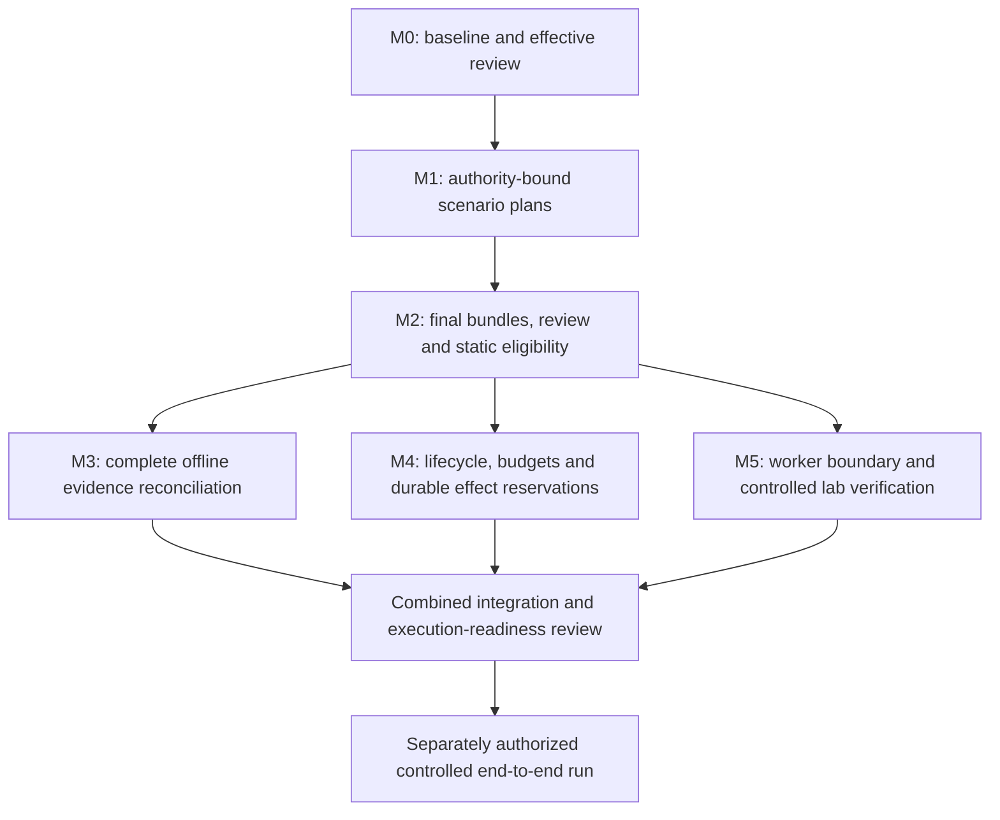

# Post-M0 foundation sequence

Date: 2026-10-23 (Asia/Calcutta). Status: **PROPOSED; documentation only**.
The first post-M0 implementation scope is [M1](M1_AUTHORITY_BOUND_PLANS.md), revision
`M1-SPEC-2026-10-25-v2`. No milestone here authorizes generated execution, provider
calls, runtime integration, installation, publication or deployment.

Subsequent status: the user explicitly approved that exact M1 scope with "Go".
It is [implemented and verified offline](M1_VERIFICATION.md): 30 M1 cases plus all
48 unchanged M0 tests passed. The sequencing/rationale below remains the historical
proposal for later boundaries, not automatic M2 implementation or execution approval.

2026-10-25 documentation reconciliation: v1's review found two roadmap blockers,
adaptive routing and tested deployment portability. Both now have deferred MODEL/PORT
workstreams and evidence gates in [ROADMAP](ROADMAP.md), owned by the single
[capability register](CAPABILITY_REQUIREMENTS.md). M1-D01..06, all 30 M1 cases and M1's
offline implementation scope are unchanged. The capability register preserves broader
requirements without accepting the full ADRs or making future integrations prerequisites
for M1. The starting-point evidence below remains historical, not a new test run.

## Verified starting point

The assessment began with a clean index/worktree on `main` at
`d17974a9ac17f209ed110a86b11c504e2cc3bc49` (`feat: implement offline M0 baselines and
review records`). Locally recorded `origin/main` had the same hash. No remote query
was made; tracking refs do not prove current remote state or publication permission.

The existing command was rerun after inspecting its test boundaries:

```powershell
.\.venv\Scripts\python.exe -B -m unittest discover -s tests -p "test_*.py" -v
```

**48 tests passed in 14.280 seconds, no failures/errors/skips.** This is new offline
verification of M0, separate from the 14.953-second historical result in
[M0_VERIFICATION](M0_VERIFICATION.md). Tests use synthetic inputs, temporary stores,
controlled child Python processes, fault injection and a temporary Windows junction.
No crawler, generator, repair engine, generated Playwright or provider was executed.
This does not establish runtime safety, clean installation or hardware durability.

### Implemented interfaces inspected

| Source | Verified contract and consequence for the next milestone |
| --- | --- |
| [baseline_contracts.py:224](../app/baseline_contracts.py#L224) | `CriterionRevisionV1` separates criterion/requirement IDs, expected outcome, clarity and automation support. Unsupported does not mean unapproved. |
| [baseline_contracts.py:252](../app/baseline_contracts.py#L252) | Draft/snapshot identities and references are validated; a snapshot carries a content digest. Preserve M0 canonical bytes and V1 rules. |
| [baseline_review.py:11](../app/core/baseline_review.py#L11) | `validate_draft(raw_bytes)`, `freeze_baseline(validated_draft)` and `approval_blockers(draft)` are pure. Freezing does not approve. |
| [review_store.py:234](../app/core/review_store.py#L234) | `ReviewStore.store_snapshot(snapshot)` stores immutable content. `record_review(command, trusted_local_context)` at line 253 is a write command, not a consumer's authority-read API. |
| [review_store.py:294](../app/core/review_store.py#L294) | `get_effective_review(project_id, digest)` reports current status, decision sequence, project sequence, active and head digests. Historical successful review responses are not current authority. |
| [review_store.py:305](../app/core/review_store.py#L305) | `inspect(project_id, digest) -> InspectionV1` returns project, snapshot and effective review inside one read transaction. Use this existing interface, not separate snapshot/review reads. |
| [review_store.py:88](../app/core/review_store.py#L88) | Reads use `mode=ro` and `BEGIN`; store identity/integrity errors are explicit. A hot journal can require recovery; a consumer must not silently open in write mode. |
| [baseline_contracts.py:166](../app/baseline_contracts.py#L166) | Canonicalization knows M0 collection names. New plan collection ordering must be defined independently; changing this function could break approved M0 hashes. |
| [baseline_files.py:14](../app/core/baseline_files.py#L14) | Bounded reads and exclusive exports cover explicitly selected local files. They do not implement contained untrusted executable-bundle materialization or a hostile-filesystem boundary. |

These are actual methods/types, refining the generic function names used in earlier
specifications. The single-operator trust model remains unchanged. No M0 schema,
review transition, CLI behavior or golden vector needs to change for M1.

### Relevant runtime evidence

| Evidence | Dependency exposed |
| --- | --- |
| [planner_node:125](../app/core/react_controller.py#L125), [route_decision:323](../app/core/react_controller.py#L323) | Model action selection, incomplete generation counter and direct routing require deterministic lifecycle enforcement eventually. A new unconnected pure policy does not fix them. |
| [node_evaluator:478](../app/core/react_controller.py#L478), [build_graph:651](../app/core/react_controller.py#L651) | Evaluation increments the loop counter; startup always infers/authenticates/crawls; `done` can go to END. Budgets must cover actual dispatch, modes and finalization. |
| [_parse_batch:308](../app/agents/codegen_agent.py#L308), [TestSuite.deduplicate:187](../app/schemas.py#L187) | Test IDs derive from requirement IDs; deduplication removes same-requirement scenarios. Establish a criterion-to-many-scenarios contract before bundle/result contracts. |
| [write_spec_files:67](../app/core/evaluator_engine.py#L67) | Deletes shared files, accepts generated paths, writes all tests and transforms code. Approval must bind final bytes and the complete executable bundle. |
| [run_playwright:106](../app/core/evaluator_engine.py#L106) | Local Node inherits host environment. Neither approval nor a manifest supplies isolation. |
| [parse_results:260](../app/core/evaluator_engine.py#L260), [build_report:400](../app/core/evaluator_engine.py#L400) | Flat traversal/title matching and count-based coverage require a planned identity set, attempt identity and complete reconciliation. |
| [resume_pipeline:771](../app/core/react_controller.py#L771) | Resume invokes saved graph state; no application effect reservation accompanies dispatch. Checkpoints cannot establish whether an external mutation happened. |

This is a focused source review of existing F01-F08/F13 dependencies, not a repeated
audit or reproduction of every historical finding. All F01-F17 remain open.

## Recommendation and dependency analysis

**M1 should be authority-bound scenario planning, with an offline admission assessment.**
It consumes M0 through a read-only adapter, binds scenario identities to exact criterion
revisions, preserves every criterion's planning disposition and emits immutable proposal
bytes. It grants no plan approval, generation permission or execution permission.

This is a deliberately small vertical slice: an operator can take an existing M0
baseline, describe several scenarios, freeze a plan and learn precisely why that plan
is structurally valid, incomplete, stale or ready for artifact design. There is no new
database, generic workflow framework, second reviewer identity or result parser.



Arrows specify prerequisites, not permission. M3 and M4 need a shared minimum attempt
identity contract specified at the M2 handoff, but their implementations need not be
combined. M3 can consume synthetic attempt envelopes before M4 persists attempts.
Worker threat modeling and lab fixture design can be separately scoped alongside
offline work; no worker technology is selected here.

| Concern | Earliest useful contract | Implementation/enforcement boundary |
| --- | --- | --- |
| Deterministic lifecycle and finite budgets | M1 has a fixed bounded offline command flow; full modes/action/outcome vocabulary at M4 | M4 tests the state machine and atomic reservation against fakes. Real enforcement waits for reviewed integration; counters alone are insufficient. |
| Approval/eligibility | M1 reads current M0 authority; M2 adds plan/bundle review semantics | Static eligibility is advisory. M4/M5 must recheck current authority immediately before dispatch under a specified revocation protocol. |
| Immutable executable manifests | M2, after scenario mappings exist | Complete final bytes, helpers, configuration, lock/runtime identity; materialization verified with inert fixtures. No host discovery/import of generated code. |
| Stable scenario/test IDs | Scenario identity and baseline revision in M1; logical test/variant IDs in M2 | IDs cannot derive from titles, array positions or requirement IDs alone. One criterion may have many scenarios and each later scenario may have multiple concrete tests/configurations. |
| Complete results | M1 supplies the full criterion set; M2 supplies planned tests/configurations; M3 supplies evidence semantics | Recursive bounded parsing and reconciliation of all planned identities; no inferred pass for missing evidence. |
| Effect identity/recovery | Shared attempt envelope before M3; durable reservations in M4 before effects | Idempotent reservation, uncertain outcomes, conservative usage accounting and cancellation reconciliation. M0 review-request idempotency is not browser-effect idempotency. |
| Isolated execution | Explicit no-execution boundary throughout M1-M4; M5 worker contract | External network/process/filesystem enforcement and trusted evidence collection. Hashes do not prove safe or honest test code. |

## Why not M1A policy, M1B manifests/eligibility, M1C results?

The split separates useful concerns, but **the proposed order is incomplete** if M1A
means a complete lifecycle enforcing approvals and execution budgets. Such policy needs
subjects, revisions, attempts and effect reservations that M1B and the omitted recovery
work have not yet defined. Boolean placeholders such as `approved=True` would reproduce
the existing authority problem. An in-memory counter resets after a crash and does not
account for an interrupted provider request that may still be charged.

Pure transition tests may be drafted early; they are not a complete foundation milestone
unless their limited guarantee is stated. The minimum always-deny execution rule belongs
in each new offline boundary immediately. Full policy becomes valuable after the concrete
subjects exist, and belongs with durable reservations before real effects.

| Alternative | Benefit | Cost / why not selected |
| --- | --- | --- |
| Original A/B/C, policy first | Quickly tests obvious routing/budget failures | Either relies on undefined eligibility facts or expands A to include artifacts/effects. Useful only as a clearly non-enforcing simulation. |
| One combined foundation milestone | Fewer handoffs; one integrated model | Large approval/review surface: new identity, filesystem, review, persistence, lifecycle and accounting semantics at once. Failures are harder to isolate. |
| Manifest/eligibility first, with scenarios embedded | Produces a stronger artifact deliverable sooner | Reasonable alternative if review overhead outweighs slice size; includes final-byte closure, path policy and additional approval persistence before proving the M0 consumer. |
| Patch legacy approval flags and title matching | Fewest changed lines | Leaves same-file rejected code, transformed bytes, replay and scenario loss unresolved; cannot meet the required guarantees. |
| M1 authority/plan, then M2 artifacts, M3 results and M4 policy/effects | Concrete inputs stabilize each subsequent contract; no M0 migration | One extra handoff and deferred runtime fixes. Acceptable only while generated execution remains prohibited. Recommended. |

The recommendation would be disproved if the product can justify a strict one-scenario
per criterion model, or an existing immutable scenario inventory is found, or a reviewed
M2 implementation plan demonstrates that separate M1 adds no independently useful check.
Current source has neither of the first two properties. Do not add a general plan workflow
engine merely to justify this split.

## Milestone boundaries, evidence and residual risk

Only M1 has a detailed implementation specification. M2-M5 below are bounded roadmap
proposals, not approved schemas or implementation plans.

### M1 - Authority-bound scenario plans

- **What/why now:** make the first real read-only consumer of M0 and establish the
  exact planned criterion/scenario set before artifact review and result accounting.
- **How/modules:** new plan contracts, pure validation, an adapter using `ReviewStore.inspect`,
  and a separate offline CLI; preserve M0 and all existing runtime files.
- **Alternative/trade-off:** UUIDv4 scenario IDs plus a registry would need persistence;
  project/criterion-scoped deterministic scenario keys avoid that store, but operators
  must retain keys for the same logical scenario. Folding this work into M2 is possible.
- **Failures/invariants:** stale approval, cross-project IDs, contradictory support,
  dropped criteria, empty plans and misleading readiness; no serialized readiness token
  authorizes an effect. Baseline expectations remain the sole oracle reference.
- **Evidence:** the [M1 acceptance matrix](M1_AUTHORITY_BOUND_PLANS.md#offline-acceptance-matrix)
  covers real temporary M0 stores, blocked states, canonical bytes and no effects.
- **Still unsafe:** no artifact review, execution restriction on the old CLI, result
  reconciliation, budgets, replay or sandbox. Scenario text is not proven semantically faithful.

### M2 - Final bundles and static eligibility

- **What/why next:** bind a plan to exact executable inputs and explicit review before
  discussing permission to run them. M0 approves expectations, not code.
- **How/modules:** proposed `artifact_contracts`, `artifact_validation`, `artifact_files`
  and separate artifact-review persistence; consume M1 and M0 read APIs. Preserve M0 V1
  schema fingerprint; do not add tables to its database without a separately approved migration.
  Define logical test/configuration IDs and the minimal run/attempt correlation envelope here.
- **Alternative/trade-off:** filter legacy tests in place is shorter but shared modules
  execute regardless of test selection. Whole final-bundle review is more work but closes
  that gap. Plan-only review before provider generation can be distinct from final-code review;
  settle its UX/persistence before this milestone, not by overloading M0 baseline reviews.
- **Failures/invariants:** missing imported files, changed shared fixture/config/lockfile,
  stale baseline/review, path traversal/case collisions/reparse points and incomplete
  publication must deny eligibility. A declared manifest is not proof of dependency closure;
  unresolved/dynamic imports must block or await isolated validation.
- **Evidence:** inert-byte temp-directory tests; tampered/omitted dependencies; rejected
  code sharing a file; pending/revoked approvals; exact-byte no-transform materialization;
  publication crash/disk errors. Do not use `playwright --list` on the host.
- **Still unsafe:** static checks cannot establish semantic honesty, safe runtime imports,
  network isolation or race-free dispatch. The old runner stays unsafe.

### M3 - Complete offline result reconciliation

- **What/why after M2:** ensure every planned test/configuration has a truthful outcome
  and every reported observation is attributable. Requires manifest identities, not a live runner.
- **How/modules:** proposed `result_contracts`, `result_parser`, `result_reconciliation`;
  separate from effectful `evaluator_engine.evaluate`. Consume M0/M1/M2 and synthetic
  attempt envelopes; later adapters replace the old parser/report only under explicit scope.
- **Alternative/trade-off:** write a custom reporter immediately vs first proving that
  the pinned existing reporter exposes enough identity; prefer the latter, verified against
  installed source/fixtures at implementation time. No current reporter compatibility claim.
- **Failures/invariants:** recursively handle nested suites, duplicate titles, retries,
  skipped/interrupted/expected failures, unknown/duplicate/missing IDs and runner errors.
  Untrusted annotations cannot grant identity or success outside the manifest.
- **Evidence:** fixture matrix including two unknown passing IDs against one criterion,
  zero planned tests, missing expected evidence, mixed browser configurations and changed
  attempt/bundle IDs; exact set reconciliation, not percentage clamping.
- **Still unsafe:** synthetic output is not trusted live evidence or proof of an assertion's
  honesty. No replay, real cancellation, budget enforcement or defect adjudication.

### M4 - Deterministic lifecycle and durable reservations

- **What/why before effects:** make legal actions, finite budgets and crash recovery one
  enforceable boundary. Planning-time checks alone become stale before dispatch.
- **How/modules:** proposed `lifecycle_policy`, `run_contracts`, `run_store`, `effect_policy`;
  tests use fake providers/workers and clocks. Consume M2 subjects and M3 outcome vocabulary.
  Version future graph state; preserve and reject incompatible legacy checkpoint resumes.
- **Alternative/trade-off:** in-memory pure policy is simpler for simulation; transactions
  are required once repeats can consume money or mutate a target. A single-host store and
  one dispatcher precede leases/fleets/brokers; no distributed workflow platform is assumed.
- **Failures/invariants:** reserve action identity and counts/time/usage allowance before
  dispatch; duplicate reservation is not another invocation; pending/revoked/stale subjects
  block. Unknown cost stays reserved/unknown. No refund/retry merely on timeout/lease expiry.
  Define the authority-check/dispatch linearization point and revocation of in-flight work
  explicitly; separate databases are not an atomic transaction. Ambiguous effects become
  uncertain, never automatically repeated. All normal terminal paths finalize once.
- **Evidence:** complete mode/transition matrix, repeated generation, invalid planner action,
  budget exhaustion, fake clock/deadline, duplicate deliveries, stale results and crash injection
  before/after reservation/dispatch/evidence commit. Model/provider fallbacks share total budgets.
- **Still unsafe:** offline reservation tests do not prove target-side exactly-once behavior,
  OS cancellation or worker isolation. Actual graph integration and target mutation policy
  remain reviewed integration work; no old-runner fallback.

### M5 - Worker boundary and controlled execution readiness

- **What/why before generated execution:** independently enforce host-secret, filesystem,
  process, destination and evidence boundaries; no earlier milestone supplies these.
- **How/modules:** proposed `worker_contracts`, supervisor/adapter and owned lab fixtures;
  consume immutable bundles, reservations, cancellation and bounded evidence contracts.
  Research/compatibility work requires its own scoped authorization, not this assessment.
- **Alternative/trade-off:** continue entirely offline (simplest and safest) vs a disposable
  VM/validated sandbox vs a hardened dedicated-host container. Choose using threat-model and
  compatibility evidence; no vendor, install or deployment decision here.
- **Failures/invariants:** enforce policy outside generated code for direct Node HTTP and
  browser traffic, redirects/DNS/private addresses, child processes and test discovery/config
  loading. Credential handles remain scoped; no host workspace/provider-key mounts.
- **Evidence:** synthetic-secret denial, path/egress/resource/output tests, timeout/cancel
  process-tree termination, tampered-bundle denial, cleanup and stale-worker publication tests;
  independently observed lab outcomes and crash windows.
- **Still unsafe:** a working boundary does not prove oracle fidelity, broad application
  compatibility or reliable repair. A combined review must authorize the first controlled
  end-to-end run separately; public arbitrary-target execution remains out of scope.

## Product continuity and unresolved decisions

The [roadmap](ROADMAP.md) retains professional UI, separate public showcase, controlled
lab, POM generation, observability/model telemetry, model/agent evaluation, safe repair,
and deployment/operations. M1 supplies useful synthetic states for their later design,
not permission to implement them. The existing showcase already has a scope and a named
delivery row; its acceptance evidence is broad. A small SC-01 checklist now makes that
existing deliverable independently reviewable without adding a new website project.

At the original proposal gate, decisions requiring owner approval were the M1 boundary, deterministic scenario-key
identity, full criterion disposition, exact admission semantics and no new plan authority
store. See [M1 approval gate](M1_AUTHORITY_BOUND_PLANS.md#implementation-approval-gate).
Later decisions must not block writing this proposal:

- Whether plan review must precede any provider spend, and who reviews final bundles;
  authentication is required before expanding beyond M0's local trusted operator.
- Supported scenario classes/configurations, required negative/boundary cases and when
  a scenario is sufficiently faithful; structural checks cannot decide business adequacy.
- Result definitions for expected failure, flakiness, partial evidence and unsupported
  criteria; distinguish planning completeness, execution completeness and supporting evidence.
- Run modes/exit outcomes, budgets (including unknown usage and maximum wall time),
  cancellation guarantees, recovery policy and permitted target mutations.
- Authority rechecks/revocation during dispatch and in-flight work; host/store concurrency,
  worker isolation, credential/provider data policy, retention and backup behavior.
- UI audience, showcase content/licensing/publication approval, evaluation thresholds and
  supported deployment/runtime baseline. No quality/cost/latency target is invented.

No new external research was needed for this source-based sequencing decision. Existing
ADRs retain their research provenance and PROPOSED status. M0 contracts remain approved
and unchanged; this proposal neither reopens their resolved decisions nor closes runtime findings.
