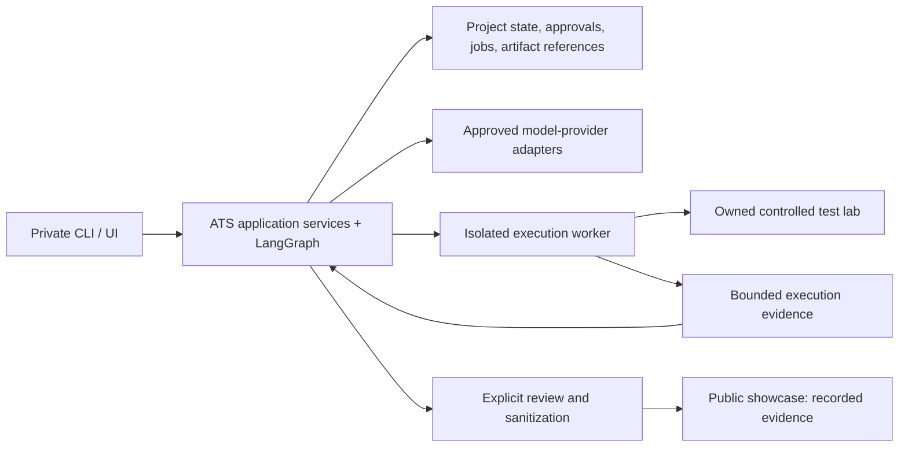

# Product and engineering roadmap

**PROPOSED delivery unless separately authorized.** This document owns sequencing,
workstream trade-offs and SC-01 acceptance; [CAP requirements](CAPABILITY_REQUIREMENTS.md)
own cross-cutting obligations, [CURRENT_STATE](CURRENT_STATE.md) owns current verified
status and [DECISIONS](DECISIONS.md) owns choices/authorization. No workstream or vendor
is approved merely by being listed. M0/M1/M2 are complete offline; the unchanged next
recommendation is the bounded [M2-R specification](NEXT_STEPS.md#next-bounded-specification---unchanged-recommendation).

Load the relevant section through the [documentation index](README.md#level-2---task-specific-authorities).
The [prior preamble](history/CONTEXT_BEFORE_2026-10-25.md#roadmap-product-and-engineering-roadmap)
preserves dated research, review/status and sequencing provenance; detailed workstreams
below are unchanged. Earlier research URLs do not imply a new research or execution cycle.

## Product definition and missing requirements

The strongest initial user hypothesis is a **QA engineer or developer testing an application they own**, with requirements available and authority to approve test expectations.

The primary job is:

> Turn documented behavior into reviewable scenarios and manual test cases, optionally automate an explicitly selected scope, then explain what was designed/executed, what evidence exists, and what remains uncertain.

The value proposition needs measurement: less authoring and diagnosis effort **without reducing defect detection or assertion fidelity**.

Recommend an initial product with:

- One operator and explicit projects; manual design/review/export can ship independently of a later explicitly authorized execution worker.
- Text-based PDFs and versioned requirement JSON; unsupported or ambiguous content remains visible.
- Desktop Chromium testing of owned web applications with controlled test data.
- Explicitly supported guest and form-login flows, expanded only through fixtures and tests.
- Reviewed business criteria, scenario plans and manual cases as distinct subjects; optional selected TypeScript/POM automation with separate artifact review.
- Evidence-backed results and human-reviewed repair proposals.
- CLI access first, followed by a private UI using the same application services.

Keep native mobile, unrestricted website testing, CAPTCHA/MFA bypass, arbitrary source builds, general security certification, and unattended business-rule changes outside the first release.

Missing product requirements include ownership/approval roles, supported requirement classes, target authorization, provider data policy, retention, cancellation behavior, run outcomes, deployment audience, and budget limits.

Proposed non-functional acceptance criteria should include:

- Every planned test receives an explicit result or missing-evidence outcome.
- No pending/rejected artifact executes.
- Approved criteria and generated artifacts are versioned.
- Restart and cancellation preserve evidence and expose uncertain effects.
- Every run has finite time, invocation, retry, and spending limits.
- Secret exposure and cross-project access are tested failure conditions.
- Performance targets are measured on a named workload; no unsupported availability or latency claims.

These define product reliability more usefully than an aggregate “AI quality” score.

## Domain workflows and test-design delivery

[CAP-AUTHENV](CAPABILITY_REQUIREMENTS.md#cap-authenv---authentication-aware-discovery-and-environment-identity)
owns environment/identity/session/discovery/challenge requirements;
[CAP-MANUAL](CAPABILITY_REQUIREMENTS.md#cap-manual---manual-cases-incremental-design-and-selective-automation)
owns cases/import/export/manual execution/incremental selection;
[CAP-COVERAGE](CAPABILITY_REQUIREMENTS.md#cap-coverage---test-design-methods-and-truthful-coverage)
owns finite design obligations and versioned denominators. Detailed decisions, methods,
metric policy and A-F journeys live in [the domain review](DOMAIN_WORKFLOWS_REVIEW.md),
not duplicated wire specifications. All are deferred pending their own scoped designs.

A manual-design journey must stop after review/export with no mandatory auth, crawling,
provider, code generation or execution. Existing scenario prose can inform a draft,
but M1 is automation-constrained and is not reviewed manual-case authority. Cases for
manually testable automation-unsupported criteria need a later compatible contract.
Selective automation requires an explicit versioned selection/impact policy while
retaining full project coverage/gaps; M2's unbuilt-scenario blocker remains unchanged.
Environment names never authorize target/IdP access or mutations; distinguish real
profile/account/tenant/data/reset/secret/budget restrictions before protected integration.
Authorized OTP/MFA/CAPTCHA test modes or human checkpoints are distinct from bypass.

## Product architecture and the three system boundaries

Recommend a **modular Python application with a separately isolated execution worker**. Maintain logical module boundaries without creating a fleet of microservices.

The showcase has no public route into the execution worker.

| System/deployment | Recommended boundary | Cost and trade-off |
|---|---|---|
| **ATS product: local/private pilot** | Local control application; disposable VM or validated sandbox for execution | Low control-plane overhead; worker provisioning and recovery still require engineering |
| **ATS product: hosted private MVP** | Authenticated API/UI, relational database, artifact storage, isolated worker pool | Adds recurring compute, storage, monitoring, backups, and security operations |
| **ATS showcase** | Static website and sanitized evidence bundles | Small operating surface; cannot demonstrate unrestricted live execution |
| **Controlled test lab** | Owned application, disposable data, pinned builds and defect variants | Setup effort buys reproducibility and trustworthy evaluation |

Retain SQLite for a single-host pilot if concurrency and recovery tests support it. Prefer PostgreSQL when independent API/worker processes and concurrent users become requirements. Add object storage when artifacts leave the local host. A transactional jobs table is a simpler initial queue than introducing Redis or a broker.

Budget using:

`model usage + worker time + evidence storage/egress + observability + operational effort`

No credible monthly estimate is possible until run volume, trace retention, model selection, and worker lifetime are specified.

## Software and agentic architecture

Separate these responsibilities:

| Boundary | Responsibility |
|---|---|
| Requirements | Source evidence, revisions, criteria, ambiguity and approval |
| Planning/generation | Scenario proposals and versioned code artifacts |
| Policy | Eligibility, destinations, budgets, permissions |
| Orchestration | Valid transitions, interruptions, job coordination |
| Execution | Isolated process lifecycle and bounded evidence collection |
| Assessment | Result reconciliation, failure hypotheses, repair proposals |
| Persistence/telemetry | Durable records, artifacts, operational diagnostics |

Models are useful for extraction, scenario suggestions, code generation, and bounded diagnosis. Ordinary code must control approvals, IDs, file paths, transitions, execution, and budgets.

Retain LangGraph, but replace planner discretion over mandatory prerequisites with deterministic transitions:

`ingest → review criteria → approve plan → generate → validate/review → execute → assess`

Repair creates a new artifact revision and returns through validation and eligibility checks. A model may suggest a recovery action only from actions currently permitted by policy. This follows the broader principle of using predictable workflows for defined tasks and adding autonomy only when evaluations show a benefit. [Anthropic engineering guidance](https://www.anthropic.com/research/building-effective-agents)

Proposed core records:

`Project → SourceRevision → Requirement → CriterionRevision → Scenario → ArtifactRevision → Approval → RunAttempt → TestAttempt → Finding`

Graph state should hold IDs, versions, budgets, and references—not credentials, database connections, or large raw evidence.

For a future API, start with project/source creation, revision-bound approvals, run creation/status/cancellation, and paginated evidence access. Use idempotency keys for commands and revision checks for stale approvals. SSE with resumable event cursors—or polling initially—is sufficient for progress.

Durability requires an effect ledger, unique job identity, leases, atomic state changes where possible, and reconciliation after crashes. Checkpoints alone do not provide exactly-once external effects: LangGraph can re-execute node code on resume. [LangGraph replay guidance](https://docs.langchain.com/oss/python/langgraph/graph-api#re-execution-and-idempotency)

A browser purchase or destructive action may not be safely repeatable. After an ambiguous interruption, record uncertainty and require reconciliation rather than blindly retrying.

## Professional UI and UX

Organize navigation around projects and evidence, rather than agent names.

| Area | Primary content |
|---|---|
| Project setup | Target scope, environment, credentials references, data/provider policy, budgets |
| Requirements and plans | Source-to-criterion comparison, ambiguities, unsupported items, scenarios, separate baseline/plan decisions |
| Manual cases and selection | Setup/data/actions/expected checks, case review/diffs/import/export, explicit automation selection and unchanged full-project gaps |
| Environment and role discovery | Profile/tenant/account references, mutation/reset scope, redacted role observations, auth/challenge expiry; no secrets in general logs |
| Code | POM/component/fixture/spec explorer, validation findings, revision diff, traceability |
| Runs | Status, stage timeline, tests, logs, model calls, browser evidence, costs, cancellation |
| Findings and repairs | Expected versus observed behavior, classification evidence, original/repaired diff, approval |
| Evaluations and settings | Benchmark comparisons, historical runs, retention, providers, access and operational controls |

The key journey is:

**Configure → inspect extraction → approve criteria/scenarios → inspect code → authorize execution → investigate evidence → approve or reject repair.**

Use a persistent run header with target/build, baseline revision, status, budget consumption, and evidence completeness. Selecting a failed test should reveal its criterion and browser evidence before presenting an AI explanation.

Recommended visual system:

- Neutral surfaces, one interaction accent, semantic status colors with text/icons.
- Explicit tokens for surface, border, text, focus, status, spacing, typography, and density.
- Readable interface typography; monospace for code, IDs, and logs.
- Reusable status badges, evidence panels, approval cards, timeline rows, tables, and diff views.
- Desktop split panes; narrow layouts stack evidence and details. Avoid automatic log scrolling that steals the reader’s position.
- No decorative agent animation or unexplained confidence gauges.

Target WCAG 2.2 AA: keyboard operation, visible/unobscured focus, accessible names, contrast, status announcements, sufficient targets, and reflow. Verify with automated checks plus keyboard and screen-reader journeys. [W3C guidance](https://www.w3.org/WAI/WCAG22/quickref/)

Validate the design through tasks such as “find why this criterion lacks evidence” and “reject an assertion-changing repair,” measuring completion and errors.

## Public showcase

Build the showcase around one defensible case study:

**Requirement → approved criterion → generated POM/spec → controlled defect → evidence → classification → repair decision.**

Provide architecture explanations, code excerpts, recorded runs, benchmark methodology, limitations, and an interactive evidence explorer.

Every experience should visibly say **LIVE**, **RECORDED**, or **PLANNED**. Recorded results should identify the ATS commit, lab build, dataset version, and run date.

Start with static data and client-side exploration. Do not accept public arbitrary URLs, SRS uploads, credentials, or executable code. Any later live demo should offer a fixed scenario catalog in the owned lab with disposable state and quotas.

Publication needs a separate review of documents, screenshots, cookies, prompts, metadata, licensing, and target data. A private application report is not automatically suitable for publication.

### SC-01 - Separately trackable public showcase deliverable

Status: **PROPOSED / NOT BUILT / NOT AUTHORIZED FOR PUBLICATION**. Scope: one static
case-study page plus a client-side evidence explorer using a versioned, sanitized
recorded bundle. This is distinct from the private professional application UI and
does not depend on deploying that product. No public target URLs, uploads, credentials,
model calls or execution endpoints. A synthetic prototype may precede controlled-run
evidence only if explicitly labeled synthetic/planned; it cannot claim a recorded ATS run.

| Acceptance | Required evidence before declaring SC-01 complete |
| --- | --- |
| SC-AC-01 | One navigable requirement -> criterion -> scenario -> artifact -> result/repair-decision story, with unavailable capabilities visibly PLANNED |
| SC-AC-02 | Every recorded run identifies ATS commit, baseline/plan/bundle identity where available, lab build, dataset version, run date and methodology; no invented benchmark claims |
| SC-AC-03 | Visible LIVE/RECORDED/PLANNED labels and explicit synthetic-fixture disclosure; no ambiguity about executing a current test |
| SC-AC-04 | Reviewed export manifest and sanitization/licensing checklist covering prompts, screenshots, metadata, cookies and target content; no secrets/private raw inputs |
| SC-AC-05 | Keyboard-readable evidence navigation, narrow-screen layout and working local links verified against the prepared static artifact |
| SC-AC-06 | Inspection demonstrates no route from the showcase to ATS worker/provider/credential services; static artifact and publication destination reviewed separately |

Preparation completion requires the local artifact and SC-AC-01..06 evidence. Public
release is a second explicit approval/delivery event with a verified destination URL.
This task only clarifies scope/acceptance; it does not build or publish SC-01.

## Controlled Test Lab

Create a small owned web application with login/roles, a filterable list, a validated form, and a state-changing workflow. Keep it understandable enough to manually verify.

Maintain:

- A reviewed requirement/criterion baseline.
- A known-good build.
- Individually selectable defect variants.
- Deterministic seed/reset operations, controlled time, and disposable accounts.
- Independent reference tests verifying each defect.
- Pinned application, fixture, and browser identities.

| Variant | What ATS must distinguish |
|---|---|
| Wrong total/count | Genuine requirement violation |
| Unauthorized role access | Genuine authorization defect |
| Broken filtering | Genuine behavioral defect |
| Changed locator, same behavior | Test defect eligible for bounded repair |
| Unavailable service or failed setup | Environment failure |
| Ambiguous specification | Unknown; request clarification |
| Malicious webpage/document instruction | Untrusted content; no policy override |

The same generated test should be examined against the good and defective builds. Passing on the good build and failing appropriately on the mutant is stronger evidence than a pass alone.

The Internet on Heroku can supplement compatibility exploration after authorization. It cannot supply controlled resets, known defect labels, or benchmark provenance.

## Observability and telemetry architecture

Maintain three distinct records:

1. **Product/audit events:** approvals, transitions, artifact publication, execution eligibility and outcomes.
2. **Diagnostic telemetry:** traces, logs, timings, retries, model calls and worker resources.
3. **Evaluation results:** scores against independently defined benchmarks.

Product decisions must not depend on whether a tracing vendor retained or sampled a span.

Proposed event/trace contract:

| Group | Fields |
|---|---|
| Identity | `schema_version`, `event_id`, `project_id`, `run_id`, `attempt_id`, timestamp, sequence |
| Correlation | `trace_id`, `span_id`, parent/link IDs; criterion/scenario/test IDs where applicable |
| Workflow | Node/action, previous/next state, attempt, allowed-action decision, reason code |
| Provenance | ATS commit, baseline/artifact hashes, prompt version/hash, requested/resolved model, provider |
| Usage | Input/output/cached tokens where available, duration, retries, estimated cost and pricing version |
| Outcome | Status, error category, validation failures, terminal reason, evidence references |
| Audit | Actor, approval scope, reviewed revision, policy version, decision time |

Represent missing usage as **unknown**, not zero. Record every fallback attempt. Cost estimates must identify their assumptions and include retries.

Use spans for graph nodes, model requests, tools, worker startup, Playwright execution, and reconciliation. Persist graph transitions as events. Link attempts across resumptions instead of pretending a paused run was one uninterrupted process.

Track queue age, worker CPU/memory, cancellations, timeouts, missing results, validation failures, token consumption, and trace-export failures. Keep run/test IDs out of metric labels to avoid unbounded cardinality.

| Option | Assessment |
|---|---|
| Structured local events/JSONL | **PROPOSED first step** for inspectability; requires schema, bounded storage and reliable audit persistence |
| OpenTelemetry | **PROPOSED instrumentation boundary**; vendor-neutral traces/metrics/logs, but not a storage/UI backend. [Official overview](https://opentelemetry.io/docs/what-is-opentelemetry/) |
| LangSmith | Strong candidate for a LangGraph-focused pilot; supports OTLP and framework integration. ATS’s custom provider adapters still need explicit coverage. [Documentation](https://docs.langchain.com/langsmith/trace-with-opentelemetry) |
| Langfuse | Strong candidate when deployment control matters; supports OTLP ingestion. Self-hosting adds web/worker services, PostgreSQL, ClickHouse, Redis/Valkey and object storage. [OTLP](https://langfuse.com/integrations/native/opentelemetry), [deployment architecture](https://langfuse.com/self-hosting) |

Choose **one** specialist backend after a small representative trace comparison. Do not operate LangSmith and Langfuse simultaneously without a demonstrated need.

Default to metadata-only exports. Redact before export; require explicit policy for prompt bodies, DOM snapshots, screenshots and traces. Keep approvals unsampled; sample diagnostic successes only after preserving required evidence. Retention/deletion must cover datasets and exports as well as traces.

The old OTel GenAI conventions page now points to a separate repository. Pin the conventions used by the adapter instead of assuming attribute names are permanent. [Official notice](https://opentelemetry.io/docs/specs/semconv/gen-ai/)

## Model and agent evaluation

Observability explains execution. Evaluation determines whether a version performs acceptably against a defined reference.

Start with a small, human-adjudicated corpus covering negation, roles, thresholds, ambiguity, unsupported requirements, multiple scenarios, injection attempts, and known application/test/environment defects.

Separate development, validation, and held-out cases by requirement family/application variant. Prevent benchmark answers and defect identities from entering retrieval or generation context.

| Dimension | Initial measurement |
|---|---|
| Extraction | Criterion precision/recall, source-evidence correctness, lost negations/thresholds, unsupported-item retention |
| Planning | Reviewed scenario coverage, omissions, role/negative/boundary cases |
| POM output | Syntax/type/import validity, independent execution, reviewer rubric, shared-locator maintenance exercise |
| Assertion fidelity | Criterion-changing edits, vacuous checks, defect sensitivity before/after repair |
| Defect detection | Recall on seeded defects; false alarms on good builds |
| Classification | Confusion matrix, especially application defect misclassified as test defect |
| Repair | Valid test repairs / eligible test-defect cases; genuine defects still detected afterward |
| Trajectories | Forbidden actions, skipped approval, repeated work, budget violations, recovery behavior |
| Reliability | Complete reconciled runs, crash recovery, cancellation, artifact integrity |
| Efficiency | Tokens, estimated cost, model/worker latency; report sample sizes |

Report abstention separately from accuracy: a system that marks everything unknown can appear safe while providing little value.

Evaluate retrieval with relevance/recall measures **and** end-to-end memory-on/off comparisons. Evaluate prompt/model changes on identical cases and budgets, with repeated trials and uncertainty intervals.

Use deterministic validators first. LLM judges may assess semantic alignment using a documented rubric, but require calibration against human labels, disagreement review, and held-out checks. They must not independently approve changed expectations. Official evaluation guidance likewise distinguishes datasets, code evaluators, human review, and carefully reviewed LLM judgments. [LangSmith evaluation concepts](https://docs.langchain.com/langsmith/evaluation-concepts)

Initial release gates should prohibit observed approval bypass, oracle weakening, and boundary violations in the mandatory corpus. Numerical quality thresholds need baseline measurements and an explicit decision. **No benchmark results were produced in this assessment.**

## Security and reliability gates

Before **any generated-code execution**, require:

- An approved execution boundary with no host workspace, provider credentials, Docker socket, or unrelated secrets.
- Disposable filesystem and identities, resource/process limits, cancellation, and bounded output.
- Network enforcement outside generated code, covering direct Node HTTP, browser traffic, redirects, DNS resolution, retries and private/metadata addresses.
- Revision-bound execution approval and immutable artifact manifests.
- Safe path handling, including Windows absolute/UNC paths, traversal, symlinks/reparse points and collisions.
- Validation of generated artifacts; type-checking/import inspection that can execute project code must itself occur within an appropriate boundary.
- Safe rendering of evidence and authenticated, run-bound feedback.
- Evidence preservation on failure.

A Playwright container alone is insufficient assurance. Official guidance warns about untrusted sites and root execution disabling the Chromium sandbox. [Playwright Docker guidance](https://playwright.dev/docs/docker)

Compare a disposable VM with a managed sandbox or gVisor-based worker through compatibility, escape-resistance, networking, startup time and cost tests. gVisor offers a distinct isolation boundary but documents compatibility and syscall overhead trade-offs. [gVisor architecture](https://gvisor.dev/docs/)

Prompt separation and injection detection are useful layers; permissions must still be enforced outside the model. Treat source files, PDFs, webpages, tool outputs and retrieved lessons as untrusted. [OWASP prompt-injection guidance](https://cheatsheetseries.owasp.org/cheatsheets/LLM_Prompt_Injection_Prevention_Cheat_Sheet.html)

Destination allowlists must bind to actual connections, not just validate the initial hostname. Redirects and DNS rebinding require explicit handling. [OWASP SSRF guidance](https://cheatsheetseries.owasp.org/cheatsheets/Server_Side_Request_Forgery_Prevention_Cheat_Sheet.html)

Before **hosted access**, add authenticated sessions, object-level authorization, TLS, rate limits, upload limits, backup/restore, deletion workflows and incident controls. Before **multiple users/tenants**, add enforced project isolation, scoped roles, fair scheduling and cross-tenant tests.

Generated code can also fabricate evidence. Sandbox isolation protects the host; it does not prove honest assertions. Reviewed artifacts, trusted collection boundaries, independent reconciliation and differential defect tests address that separate risk.

## SDD and development-harness design

Use the requested lifecycle:

`product need → approved specification → decision → contract → acceptance test → implementation → verification → updated state`

Keep documentation small:

- A concise PRD: users, scope, journeys, non-goals, measurable requirements.
- One bounded feature specification per milestone.
- ADRs only for consequential alternatives.
- Executable schemas/API contracts beside implementation.
- A threat model and evaluation specification.
- Existing current-state, findings and next-steps documents as the status/handoff record.
- Runbooks when operational behavior actually exists.

Trace identifiers such as `FR-*`, `NFR-*`, `AC-*`, and `ADR-*` into tests and verification records. Avoid copying the same contract into several documents.

For Codex, retain `AGENTS.md`; work in bounded changes with explicit acceptance criteria, reviewed diffs, and recorded failures. Add formatting/linting, incremental typing, offline unit/contract tests, then controlled integration tests. Establish clean dependency installation and browser provisioning before claiming reproducibility.

CI should repeat verified local commands and preserve failures. Pin third-party actions and use least-privilege CI credentials when publishing is authorized.

Skills should encode proven repeated development workflows. MCP is justified when an external integration is needed; it is not a missing ATS runtime feature. Independent review is valuable at security and semantic boundaries, without requiring more runtime agents.

## POM, source understanding, memory and agentic expansion

POM remains proposed. Generate small typed page/component objects, explicit fixtures
and specs through the existing generator; keep criterion-specific assertions visible
in specs or named helpers. Functions suffice for isolated actions. Avoid a universal
base-page hierarchy. Multi-file manifests must include helper/fixture imports, validate
paths and types, and bind approval to final bytes. A shared locator maintenance exercise
and independently runnable specs are acceptance evidence, not file-count targets.

Source/API-document understanding is deferred: start with read-only, pinned source and
document provenance; files, symbols, imports and lexical search before embeddings.
Observed requests are not API contracts, and implementation behavior cannot override
approved expectations. Arbitrary repository builds remain outside the initial scope.

Use bounded run state as working memory, immutable execution evidence as episodic
memory, and reviewed recipes as procedural memory. Existing Chroma/JSON storage is
implemented, but quality gains are unverified. Scope lessons by project/domain/version,
preserve provenance/freshness and quarantine unverified repairs. Compare memory on/off
and lexical/metadata retrieval against semantic/hybrid retrieval on held-out cases.
Automatic prompt or memory promotion is rejected as a proposed design direction:
propose, evaluate, review, version and retain rollback. This is not an implemented gate.

Use an evaluated default and explicit fallbacks as the initial routing baseline;
the MODEL workstream below retains task-aware adaptive routing as a required product
capability with comparative adoption gates. Record the resolved provider/model, failures
and usage; a default/fallback is not evidence that adaptive selection is implemented.
Additional runtime agents, debate, brokers, graph databases and microservices
are deferred until equal-budget evaluation or measured workload shows a benefit.
MCP/skills are development integrations when needed, not mandatory ATS runtime layers.

## MODEL - Adaptive routing workstream

Status: **REQUIREMENTS RECORDED / DELIVERY DEFERRED; NOT IMPLEMENTED OR APPROVED**.
[CAP-MODEL](CAPABILITY_REQUIREMENTS.md#cap-model---adaptive-model-selection-and-routing)
owns task-aware suitability, provider compatibility/capability discovery, supported
reasoning effort, bounded escalation, user policy, privacy/context/quality/latency/cost
constraints, failure distinctions and abstention. CAP-EXT supplies concrete adapter
contracts; CAP-OBS/EVAL supply per-attempt evidence and comparative assessment.

Exit evidence is CAP-MODEL.A1..A5: incompatible/denied/exhausted cases dispatch nothing;
fixed held-out equal-budget comparisons evaluate default/fallback against task-aware
selection/escalation; every attempt has versioned policy/config/usage provenance.
Deployment-class/capability fixtures distinguish model from serving identity; composed
SDK/router/gateway retries remain within the same attempt/deadline/usage reservation.
Quality/latency/cost thresholds require owner review of baseline measurements, not
price-based model rankings. No provider router is chosen; defer live routing until M4
budget/reservation and data-policy boundaries exist. M1 adds no routing code or API.

## FRAMEWORK - Qualified language and runner profiles

Deferred owner: CAP-FRAMEWORK; no new milestone implementation authorized. Profile
design can be specified offline after a separately scoped request; safe collection/build/
execution qualification depends on M3/M4/M5 plus CAP-EXT/POM/EVAL/LAB. Qualify the existing
Playwright/TS/Playwright Test path first, then Playwright/Python/pytest,
Selenium/Java/JUnit and Selenium/Python/pytest under their own profile decisions. API/
non-browser work needs a justified use case and separate transport/permission semantics.
No support claim exists for these future profiles today.

Exit evidence is CAP-FRAMEWORK.A1..A4: versioned capability/dependency/runtime identity,
maintainable generation, explicit collection/invocation/result identity and common
authority/isolation checks. Compare small adapters with a universal IR before adding
abstraction; default to adapters. Preserve exact V1 bytes and unknown-field rejection;
bind future profiles/environment identities through an explicitly versioned contract.
M2-R review does not certify a profile executable. All design/build/collection effects
remain subject to execution policy. The architecture review owns detailed constraints.

## PORT - Tested deployment portability workstream

Status: **REQUIREMENTS RECORDED / DELIVERY DEFERRED; NO PORTABILITY CLAIM**.
[CAP-PORT](CAPABILITY_REQUIREMENTS.md#cap-port---cloud-and-infrastructure-portability)
owns the supported deployment profiles and storage/artifact/model/worker/telemetry seams,
externalized configuration, reproducibility, secrets, migration and platform limitations.
M0's local Windows contract remains unchanged. Name supported targets at PORT approval;
no cloud, Kubernetes, microservice split or portable worker implementation is mandated.

Exit evidence is CAP-PORT.A1..A2: reproducible named profiles run common contract/security
fixtures; a portability claim needs at least two tested profiles and an explicit
limitations matrix. Synthetic migration/rollback preserves digests, approvals, history,
artifacts, access and event correlation. CAP-EXT/DATA/RECOVERY/EXEC are dependencies;
defer extra profiles until a real hosting/migration need and adequate execution boundary
exist. This is a deployment/operations deliverable, not an M1 cloud-adapter requirement.

## Capability ownership across existing workstreams

The register's [delivery map](CAPABILITY_REQUIREMENTS.md#coverage-inventory-and-delivery-map)
is the canonical CAP-to-workstream mapping. Existing professional UI is CAP-HITL;
observability is CAP-OBS; evaluations CAP-EVAL; controlled lab CAP-LAB; safe repair
CAP-DIAG; POM CAP-POM; source-aware workflow expansion CAP-WORKFLOW; measured context/
cache/retrieval improvements CAP-EFFICIENCY. SC-01 remains CAP-SHOWCASE and retains its
independent scope/SC-AC-01..06 and separate release approval above.

CAP-EXEC, CAP-RECOVERY and CAP-DATA give explicit ownership to previously scattered
authorization/isolation, crash/cancellation/replay and data-lifecycle requirements.
CAP-EXT supplies versioned adapter compatibility only as real integrations are scoped.
These entries neither create additional frameworks nor move future work into M1.

## Dependency-aware delivery order

Every stage below requires its own scoped approval. These are proposed milestones,
not dates, delivery commitments or passing gates.

| Stage | Deliverable | Required exit evidence |
| --- | --- | --- |
| M0 - COMPLETE offline | Versioned baselines and review records | Approved v2; AC-01..33 plus 15 focused regressions passed; see M0_VERIFICATION |
| M1 - COMPLETE offline | [Authority-bound scenario plans](M1_AUTHORITY_BOUND_PLANS.md): read-only M0 adapter, stable scenarios and complete criterion disposition | All 30 M1 cases and 48 unchanged M0 tests passed; see M1_VERIFICATION; no plan/code/execution authority granted |
| M2 - COMPLETE offline | [Immutable artifact packages and mappings](M2_ARTIFACT_PACKAGES.md), M2-SPEC-2026-10-25-v2; non-authorizing assessment | [M2 verification](M2_VERIFICATION.md): M2-AC-01..26 plus 12 boundary regressions and all 78 unchanged M0/M1 tests pass; closure unverified and execution always denied |
| M2-R - APPROVED OFFLINE IMPLEMENTATION | [Approved v1](M2R_DURABLE_REVIEW.md): offline durable plan/whole-package review; C23 requests implementation/local checkpoints | M2R-D01..08 / M2R-AC-01..30 explicitly approved; verify exact subjects, trusted operator, revocation/idempotency/crash/fresh-review evidence; no execution/manual/subset expansion |
| M3 - PROPOSED boundary | Complete offline result reconciliation, after M2 | Nested/retry/unknown/missing/duplicate/runner-error fixtures; exact planned set and truthful criterion accounting |
| M4 - PROPOSED boundary | Deterministic lifecycle, finite budgets and durable effect reservations, using M2 identities, M2-R reviews and agreed M3 result vocabulary | Fake-dispatch transition/mode/budget tests; duplicate/crash/cancellation/uncertain-effect recovery; no actual runtime dispatch |
| M5 - PROPOSED boundary | Worker isolation, actual closure/discovery/materialization validation and combined execution-readiness review | Independent secret/filesystem/egress/process denials, trusted evidence, crash/cancellation/cleanup and owned lab fixtures; separate execution approval |
| MANUAL - DEFERRED independent specification | Criterion-linked case design/review/import/export, then manual evidence | CAP-MANUAL.A1..A3 and workflow A-F fixtures; usable design-only stop without authentication/worker dependency |
| Selection/impact - DEFERRED contract extension | Versioned automation subset and incremental affected-set policy | CAP-MANUAL.A3 / WORKFLOW.A3; keep full baseline, distinguish unselected/unbuilt/unsupported, preserve M1/M2 V1 semantics |
| AUTHENV - DEFERRED profile/identity contract | Named environment/role/tenant/session/challenge/discovery guarantees | CAP-AUTHENV.A1..A4 with fakes/owned lab; real integration waits for authorization/effects/isolation gates |
| COVERAGE - DEFERRED policy/fixtures | ATS-COVERAGE-2026-10-25-v1 proposed domain measurement/design policy | CAP-COVERAGE.A1..A3; finite reviewed obligations, truthful full/selected denominators, manual/automated provenance; automated reconciliation still M3 |
| Safe repair workstream | Oracle-preserving reviewed hypotheses and new artifact revisions, after controlled evidence | Real seeded defects remain detectable; uncertain causes abstain; no automatic oracle changes |
| Controlled end-to-end slice | Owned lab, reviewed scenarios, generated tests, controlled execution and evidence | Known-good/defective-build discrimination and recovery evidence |
| Maintainable POM generation | Multi-file components, fixtures and explicit assertions | Type/import checks, independent specs and shared-locator maintenance |
| Private professional UI | Revision review, run/evidence explorer, repair comparison | Task-based usability, accessibility and authorization checks |
| MODEL - Adaptive routing | CAP-MODEL with CAP-EXT/OBS/EVAL and M4 limits; deferred beyond M1 | CAP-MODEL.A1..A5; held-out task-policy comparison, deployment/capability qualification and bounded composed retries with full attempt accounting |
| FRAMEWORK - DEFERRED profiles/adapters | Named language/library/runner profiles; preserve V1, qualify TS first then additional profiles | CAP-FRAMEWORK.A1..A4; explicit profile/collection/result IDs and isolated dependency/runner qualification; M3/M4/M5 dependencies |
| PORT - Tested portability | CAP-PORT within deployment/operations; deferred beyond M1 | CAP-PORT.A1..A2; named-profile build/contract/security checks and identity-preserving migration/rollback |
| SC-01 - Safe public showcase | Separate static case study and evidence explorer | SC-AC-01..06 above; preparation and public release tracked separately |
| Production MVP | Access controls, operations, backups, retention, quotas and support scope | Operational drills and explicitly approved quality gates |
| Expansion | More targets, source understanding, retrieval and concurrency | Measured benefit, isolation and reliability evidence |

The former first milestone, trustworthy offline execution eligibility and result
reconciliation, is retained across M2/M3. Its required cases are
nested suites, retries, duplicate titles, unknown IDs, missing results, runner errors,
rejected/pending/stale approvals, Windows/POSIX paths, multiple scenarios and two unknown
passing IDs against a one-criterion baseline. Clamping percentages is not a valid fix.
See ADR-03 for the complete artifact and evidence semantics.

[POST_M0_FOUNDATIONS](POST_M0_FOUNDATIONS.md) explains each milestone's WHAT/WHY/HOW,
alternatives, modules, invariants, evidence and remaining unsafe behavior. M3 and M4 can
be developed separately after their shared identity/outcome contracts are agreed; stage
numbers do not require combining them or permitting effects. Worker/lab design can also
be separately scoped. Full lifecycle enforcement is paired with durable reservations,
not deferred until after real effects. The combined M2/M2-R/M3/M4/M5 gate still precedes
any separately authorized generated-code run.

Professional UI, Controlled Test Lab, POM generation, observability/model telemetry,
model/agent evaluations, safe repair, deployment/operations and SC-01 remain explicit
workstreams in their sections and delivery rows. No workstream is dropped by the smaller
M1 scope. Telemetry and evaluation retain independent evidence/quality gates; neither
becomes an approval authority or an unspecified replacement for the showcase.

After separately scoped approval, lab requirements/seed definitions and benchmark
annotation can proceed alongside offline contract work; UX prototypes can use synthetic
states. Telemetry integration waits for common event IDs. Worker investigation can run
independently of application integration but needs its own authorized fixtures/environment.
Live generated execution waits for the combined security/lifecycle/artifact/effect gate.
Publishing performance claims waits for measured evaluations. A static showcase may
precede a hosted product only with honest, sanitized, separately approved evidence.

## Open product and operational decisions

The owner must settle first-user/team scope, supported requirement classes and auth
flows, criterion approval authority, outcome/coverage semantics, target mutations,
worker technology, provider data/retention policy, budgets and release thresholds.
The private GitHub destination was approved and created; that does not authorize a
public showcase, license selection, deployment, live execution or subsequent pushes.
No sandbox compatibility/performance benchmark or model-quality/cost result was produced
by this handoff. Keep those claims unknown until an authorized experiment supplies evidence.
