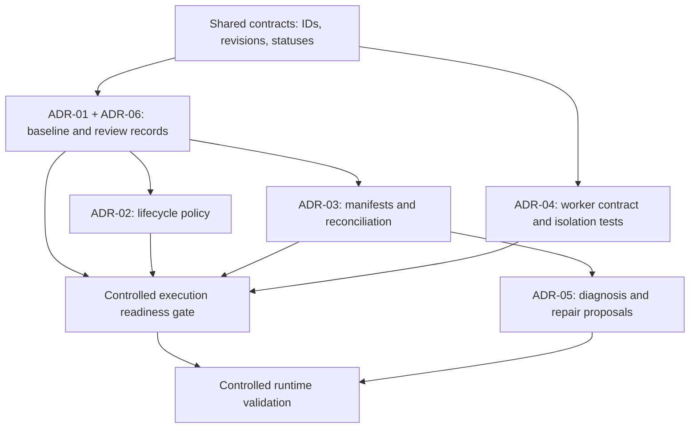

# Foundational architecture decision review

M2 completion, 2026-10-25: the exact v2 artifact-package/mapping subset is now
approved and [verified offline](../M2_VERIFICATION.md), alongside M0/M1. This supplies
immutable byte subjects and declared mappings only. Whole-bundle review, result
reconciliation, effects and isolated execution remain separately scoped; no full ADR
status changed.

2026-10-25 post-M1 dependency specification: [M2 artifact packages](../M2_ARTIFACT_PACKAGES.md)
refines the earlier broad artifact milestone into byte identity/mappings now and durable
review in later M2-R. ADR-03's whole-bundle review, reconciliation and ADR-04 isolation
requirements remain mandatory later. All six full ADRs retain PROPOSED status.

Status: **PROPOSED**, preserved 2026-10-23. This is a documentation handoff of the completed
review, not approval of implementation. The source-based audit remains in
[AUDIT_FINDINGS](../AUDIT_FINDINGS.md); implemented architecture is in
[ARCHITECTURE](../ARCHITECTURE.md). [DECISIONS](../DECISIONS.md) records authorization.

Subsequent explicit approvals cover the exact M0 baseline/review and M1 offline-plan
milestones. Both are now verified: [M0](../M0_VERIFICATION.md),
[M1](../M1_VERIFICATION.md). The six full ADRs remain PROPOSED; neither milestone
authorizes runtime integration, manifests/results, providers or generated execution.

The original proposal was challenged and revised, not automatically accepted. Six ADRs
retain their problem, current flow, realistic failure, alternatives, rationale, migration,
verification, reconsideration triggers and engineering explanation. The original handoff
ran no ADR acceptance tests; subsequent M0 verification covers only its approved subset.

## ADR register

| ADR | Proposed direction | Scope |
| --- | --- | --- |
| [ADR-01: Versioned requirements and oracle authority](01-versioned-baselines.md) | PROPOSED | F01/F04/F06 |
| [ADR-02: Deterministic lifecycle in LangGraph](02-deterministic-lifecycle.md) | PROPOSED | F04/F07/F08/F13 |
| [ADR-03: Artifact identity and result reconciliation](03-artifact-identity.md) | PROPOSED | F03/F04/F05/F06 |
| [ADR-04: Isolated generated execution](04-isolated-execution.md) | PROPOSED | F02/F03/F09/F10/F11 |
| [ADR-05: Failure classification and safe repair](05-safe-repair.md) | PROPOSED | F01/F14/F16 |
| [ADR-06: Persistence, checkpointing and replay](06-persistence-replay.md) | PROPOSED | F02/F08/F15/F17 |

## Critical assessment of the previous recommendations

| Previous recommendation | Judgment | Correction |
|---|---|---|
| Start with offline eligibility and result reconciliation | **REVISE** | Establish baseline identity and approval authority first. Otherwise a new evaluator merely trusts the existing unreliable approval flags. |
| Immutable approved criteria | **RETAIN, clarify** | Immutable objects and hashes identify content; they do not establish who approved it or whether the specification is correct. |
| Preserve LangGraph and enforce deterministic transitions | **RETAIN** | Put policy in ordinary, independently testable functions. Avoid building a second orchestration framework alongside LangGraph. |
| Approve individual generated tests | **REVISE** | Approval must cover the final executable bundle, including shared fixtures, helpers, configuration, and dependency identity. |
| Hash generated artifacts | **RETAIN, strengthen** | Hash the final bytes after all transformations. The current writer changes code during materialization. |
| Checkpoints provide durability | **REVISE** | They preserve graph state, not atomicity with subprocesses, files, or target-side mutations. |
| Automatically repair “test defects” | **REVISE** | Initially permit reviewed repair proposals only. Even a locator-only edit can change which behavior is asserted. |
| Select a sandbox technology | **INVESTIGATE** | Define the threat model and worker contract first; select an implementation after compatibility and isolation tests. |
| Add comprehensive events and traces | **RETAIN, narrow initially** | Durable approval/effect records come first. An observability platform must not become the source of authorization truth. |
| SQLite initially, PostgreSQL later | **RETAIN conditionally** | Appropriate for a single-host pilot. Concurrent services, availability requirements, and measured contention—not ambition alone—justify migration. |

A further correction: the six requested topics are not a safe implementation sequence as listed. **Persistence and replay semantics must be designed alongside approval and identity, before connecting external effects.**

## Dependency and implementation order

The common foundation is the vocabulary of **identity, revision, approval, attempts and evidence**.

The diagram separates design/testing dependencies from permission to execute.

Safe independent work after scoped approval:

- Lifecycle policy tests with fake effects.
- Manifest/parser tests using synthetic reports.
- Worker compatibility/isolation investigation against owned fixtures.
- Lab requirements and defect definitions.
- Repair-policy tests using recorded synthetic evidence.

Runtime integration waits for the combined gate. Automated repair remains disabled until its additional validation is complete.

| Future capability | Foundation it needs |
|---|---|
| POM generation | Multi-file artifact manifests, shared-fixture identity and revision-bound approval |
| Source/API-document understanding | Typed source provenance; inferred behavior cannot silently become authority |
| Memory and retrieval | Scoped evidence records, provenance, validity and quarantine |
| Model evaluations | Fixed baselines, labeled causes, artifact/attempt identity and preserved failures |
| OpenTelemetry | Correlation IDs from application records; spans remain diagnostic |
| Professional UI | Explicit pending/stale/blocked states and review history |
| Public showcase | Sanitized evidence exports with reproducible versions |
| Deployment | Worker contract, secret boundaries, recovery and retention policy |

A graph database, additional runtime agents or message broker is not required by these foundations.

## Engineering walkthrough

Consider criterion `C-17`: “A guest sees exactly four feature cards.”

1. The imported requirement is a draft with its original source reference.
2. The reviewer confirms the expectation and approves baseline digest `B1`.
3. A later scenario and artifact manifest reference `B1/C-17`.
4. The application renders three cards. Execution records the observation.
5. A repair proposes changing four to three.
6. The system identifies a changed expected outcome; ordinary repair approval cannot authorize it.
7. If the business requirement genuinely changed, the owner approves a new baseline `B2`.
8. The failed `B1` run remains historical evidence. It is not retroactively converted into a pass.

This example connects specification authority, artifact identity, classification, review and persistence without requiring extra agents.

## Scope and evidence limits

The first slice is [M0: Versioned Baselines and Review Records](../M0_VERSIONED_BASELINES.md).
Only baseline/review persistence from ADR-06 enters M0. An effect ledger, worker fleet,
new graph framework, hosted API or full event sourcing is not an M0 dependency.
The [broader roadmap](../ROADMAP.md) retains product, UI, lab, evaluations and deployment
work without authorizing it. There is no newly measured sandbox compatibility, provider
quality/cost, repair fidelity, replay safety or production-readiness evidence.
